# Artemis Mission and Spacecraft Architecting Using Gaphor (SysML)


An academic Model-Based Systems Engineering (MBSE)
project exploring the architecture of the Artemis lunar
exploration mission using the Systems Modeling Language
(SysML) and Gaphor.

The project represents Artemis as a System of Systems
(SoS), integrating mission elements, functional
subsystems, hardware architecture, requirements,
and subsystem interfaces across three levels of
engineering abstraction.

The repository preserves the original SysML diagram
exports and extends them through structured
engineering documentation, proposed requirements
traceability, interface analysis, and verification planning.

## Project Highlights

| Engineering Metric | Result |
|---|---|
| Architecture levels | 3 |
| Major mission elements | 5 |
| Functional subsystems | 8 |
| Hardware subsystem groups | 8 |
| Original SysML diagram exports | 33 |
| High-resolution diagram previews | 7 |
| Documented requirements | 60 |
| Unique documentation requirement IDs | 60 |
| Preliminary interface register entries | 16 |
| Requirement-driven interface candidates | 10 |
| Requirements with proposed verification methods | 60/60 |
| Architecture review findings | 12 |
| Technical documentation files | 6 |

**Project status:** Academic architecture modeling,
requirements documentation, and supplementary
engineering review completed. Formal editable-model
verification and physical system validation remain
outside the completed scope.

This project is not an official NASA engineering
baseline or a flight-qualified spacecraft design.

## 1. Problem Statement

Complex lunar exploration missions require
coordination between multiple spacecraft,
launch systems, ground infrastructure,
and engineering subsystems.

Managing these relationships becomes challenging
when mission requirements, subsystem interfaces,
hardware components, and verification activities
are documented independently.

Model-Based Systems Engineering provides a
structured approach to representing complex
engineering systems and organizing their
relationships across multiple architectural levels.

This project applies SysML modeling techniques
to explore these challenges through an academic
Artemis reference architecture.

## 2. Project Objectives

- Represent Artemis as a System of Systems.
- Identify major mission elements.
- Develop a three-level system architecture.
- Decompose the system into functional subsystems.
- Represent internal subsystem relationships.
- Model hardware-oriented architecture.
- Document mission, subsystem, and hardware requirements.
- Establish supplementary requirements traceability.
- Identify subsystem interface dependencies.
- Review architecture and requirements gaps.
- Develop proposed engineering verification methods.
- Preserve original engineering artifacts.

## 3. Model-Based Systems Engineering Approach

The project follows three architectural viewpoints:

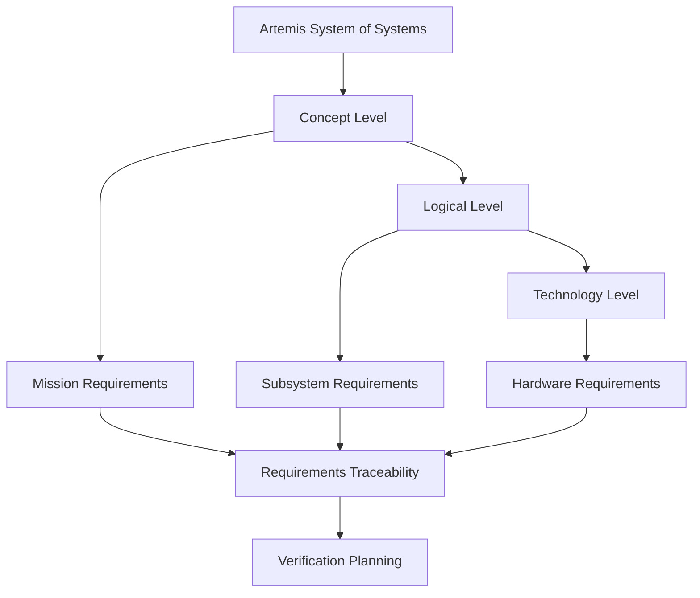

This supplementary diagram summarizes the
organization of the project artifacts.

It does not represent formally verified
allocation relationships in the editable model.

| Architecture Level | Engineering Focus | Requirements |
|---|---|---:|
| Concept | Mission scope and participating systems | 12 |
| Logical | Functional decomposition and subsystem relationships | 32 |
| Technology | Hardware architecture and components | 16 |
| Total | | 60 |

## 4. Concept-Level Architecture

The original Concept Block Definition Diagram
represents Artemis as a System of Systems.

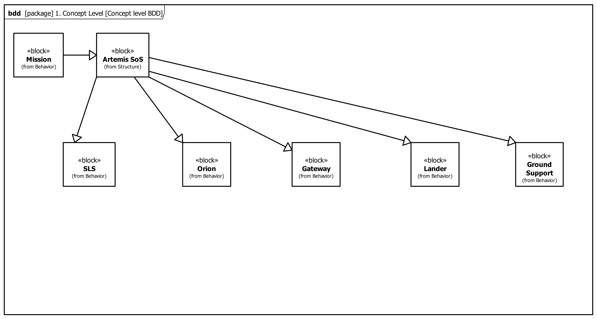

### Major Mission Elements

| Element | Intended Responsibility |
|---|---|
| Space Launch System (SLS) | Launch and mission transportation support |
| Orion | Crewed spacecraft transportation |
| Gateway | Lunar orbital support and docking |
| Lander | Lunar surface access and return |
| Ground Support | Command, telemetry, tracking, and mission coordination |

The Gateway-based architecture represents
the reference scenario adopted by this
academic study.

It should not be interpreted as the
configuration of every Artemis mission.

[Original Concept BDD](diagrams/concept_level/Concept_level_BDD.pdf)

## 5. Reference Mission Scenario

The documented mission requirements describe
transportation, docking, surface operations,
and crew return.

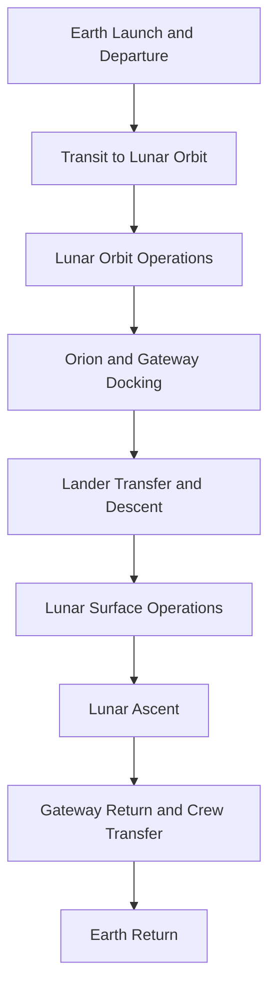

This sequence is a supplementary interpretation
of the original mission requirements.

It is not an executable mission simulation
or an original exported behavior diagram.

[Detailed Mission Overview](docs/mission_overview.md)

## 6. Logical-Level Architecture

The logical architecture decomposes the
Artemis System of Systems into eight
functional subsystems.

### Logical Block Definition Diagram

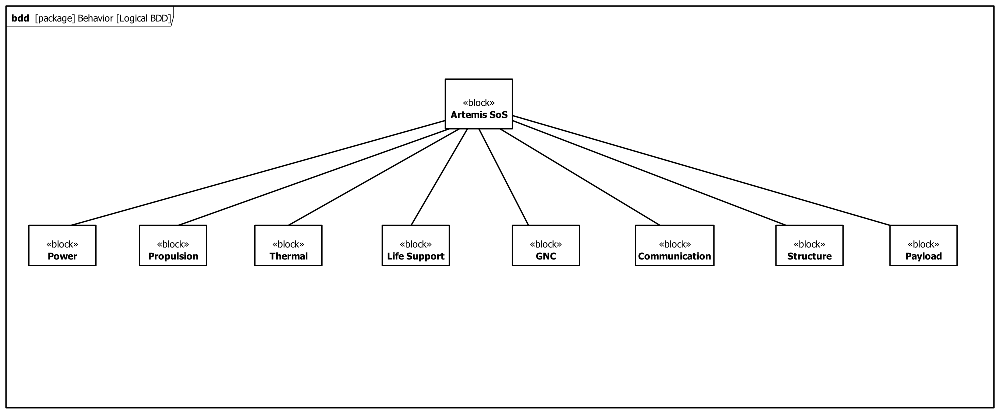

| Subsystem | Functional Responsibility |
|---|---|
| Power | Electrical power generation, storage, and distribution |
| Propulsion | Thrust generation and maneuvering support |
| Thermal | Temperature regulation and heat management |
| Life Support | Crew environmental support |
| GNC | Guidance, navigation, and control |
| Communication | Command and telemetry exchange |
| Structure | Mechanical support and structural integrity |
| Payload | Scientific instrumentation and data handling |

### Logical Internal Block Diagram

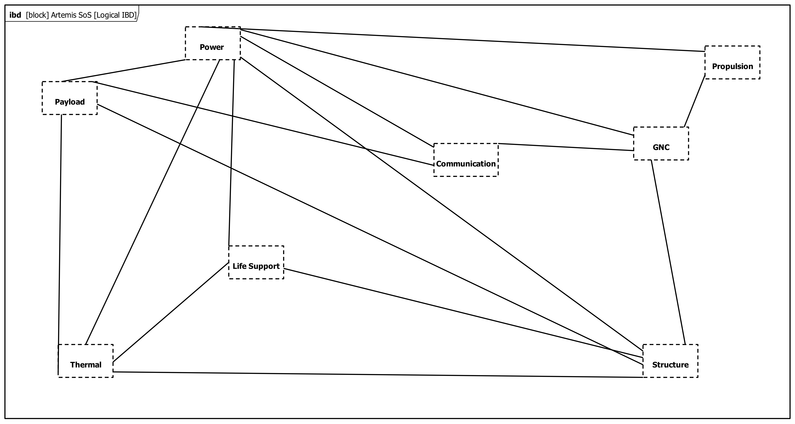

The Logical IBD represents modeled
relationships among the functional subsystems.

Detailed exchanged items, interface directions,
protocols, and quantitative limits require
further definition.

- [Original Logical BDD](diagrams/logical_level/Logical_BDD.pdf)
- [Original Logical IBD](diagrams/logical_level/Logical_IBD.pdf)
- [Structure BDD](diagrams/logical_level/Structure_BDD.pdf)
- [Structure IBD](diagrams/logical_level/Structure_IBD.pdf)

## 7. Technology-Level Architecture

The technology architecture represents
hardware-oriented subsystem decomposition.

### Technology Block Definition Diagram

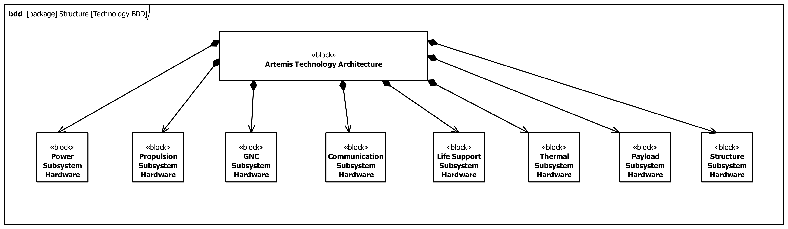

### Technology Internal Block Diagram

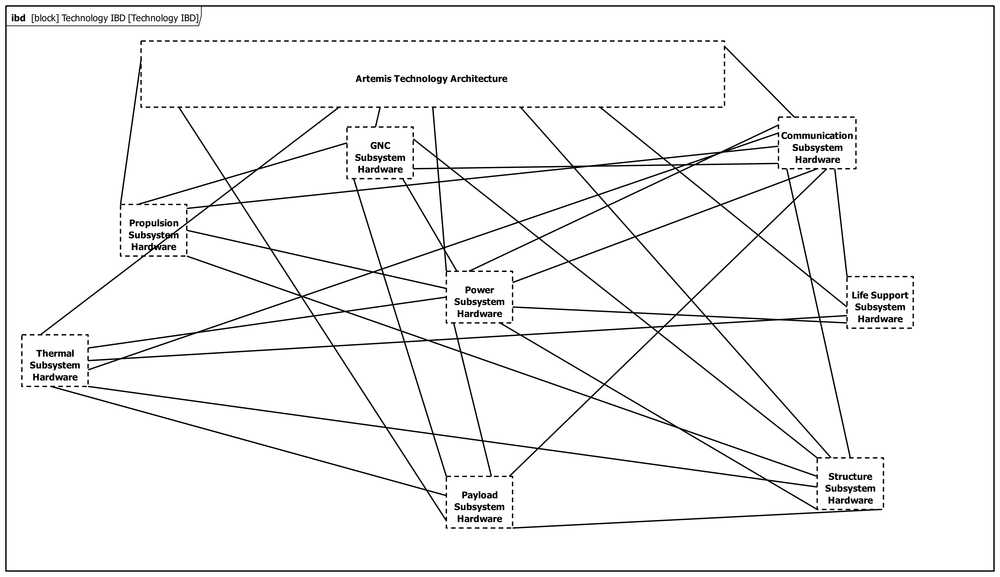

The original technology architecture contains
eight hardware subsystem groups corresponding
to the eight functional areas.

Formal logical-to-hardware allocation
relationships have not been independently
verified in the editable model.

- [Original Technology BDD](diagrams/technology_level/Technology_BDD.pdf)
- [Original Technology IBD](diagrams/technology_level/Technology_IBD.pdf)

## 8. Individual Subsystem Architecture

### Power

The original Power IBD identifies solar arrays,
batteries, a Power Conditioning Unit, a Power
Distribution Unit, and cabling.

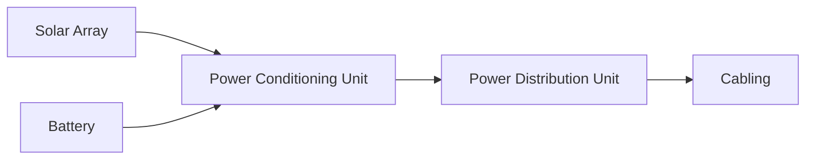

This supplementary view illustrates the intended
electrical power architecture.

[Power Subsystem IBD](diagrams/technology_level/POWER_IBD.pdf)

### Propulsion

The original propulsion architecture identifies
fuel and oxidiser tanks, feed lines, a main
engine, and an engine controller.

[Propulsion Subsystem IBD](diagrams/technology_level/PROPULSION_IBD.pdf)

### Guidance, Navigation, and Control

The GNC architecture represents sensor acquisition,
navigation processing, control processing,
and attitude-control actuators.

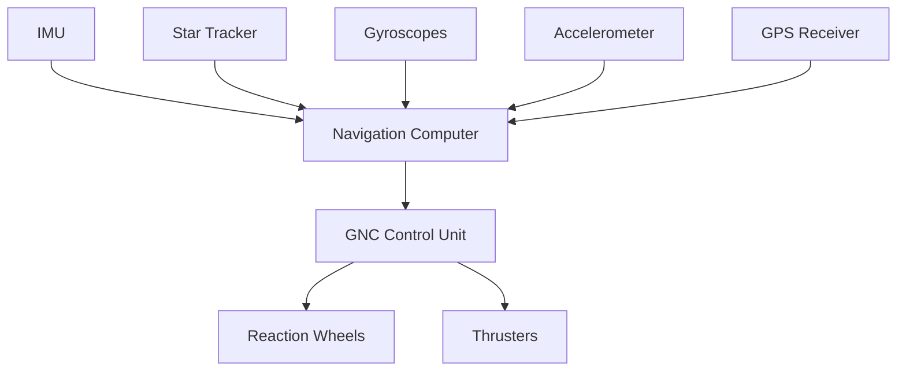

This is a supplementary interpretation of the
original component architecture.

GPS availability throughout lunar mission
phases has not been established.

[GNC Subsystem IBD](diagrams/technology_level/GNC_IBD.pdf)

### Communication

The communication architecture represents
high-gain and low-gain antennas, an antenna
pointing mechanism, an RF transceiver/modem,
an RF power amplifier, and a communication
control unit.

The original connections require further
definition to distinguish RF signal paths,
mechanical pointing interfaces, and
electrical control interfaces.

[Communication Subsystem IBD](diagrams/technology_level/COMMUNICATION_IBD.pdf)

### Thermal

The thermal architecture represents sensors,
a thermal control unit, heat exchangers,
fluid loops, and radiators.

[Thermal Subsystem IBD](diagrams/technology_level/THERMAL_IBD.pdf)

### Life Support

The life support architecture represents
oxygen support, carbon dioxide removal,
air circulation, water recovery, and
environmental control.

[Life Support Subsystem IBD](diagrams/technology_level/LIFE_SUPPORT_IBD.pdf)

### Structure

The structure architecture represents
load-bearing systems, mounting systems,
docking support, thermal interfaces,
and detailed structural components.

[Structure Subsystem IBD](diagrams/technology_level/STRUCTURE_IBD.pdf)

### Payload

The payload architecture represents
scientific instruments, data handling,
memory, payload control, and bus interfaces.

[Payload Subsystem IBD](diagrams/technology_level/PAYLOAD_IBD.pdf)

[Complete System Architecture Documentation](docs/system_architecture.md)

## 9. Requirements Engineering

The original exported SysML diagrams
contain 60 requirement entries across
three architectural levels.

### Mission-Level Requirements

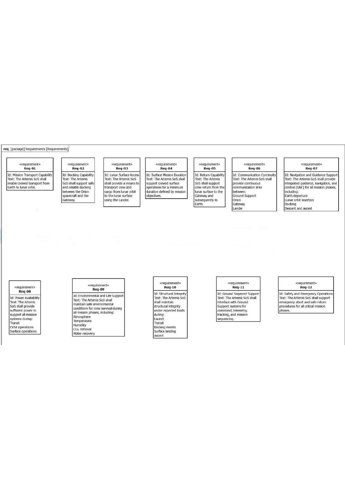

The mission requirements address:

| Qualified ID | Requirement |
|---|---|
| MIS-01 | Mission Transport Capability |
| MIS-02 | Docking Capability |
| MIS-03 | Lunar Surface Access |
| MIS-04 | Surface Mission Duration |
| MIS-05 | Return Capability |
| MIS-06 | Communication Continuity |
| MIS-07 | Navigation and Guidance Support |
| MIS-08 | Power Availability |
| MIS-09 | Environmental and Life Support |
| MIS-10 | Structural Integrity |
| MIS-11 | Ground Segment Support |
| MIS-12 | Safety and Emergency Operations |

[Original Mission Requirements](diagrams/requirements/mission_level/Requirements.pdf)

### Subsystem and Hardware Requirements

| Subsystem | Logical Requirements | Hardware Requirements |
|---|---:|---:|
| Power | 4 | 2 |
| Propulsion | 4 | 2 |
| Thermal | 4 | 2 |
| Life Support | 4 | 2 |
| GNC | 4 | 2 |
| Communication | 4 | 2 |
| Structure | 4 | 2 |
| Payload | 4 | 2 |
| Total | 32 | 16 |

### Qualified Requirement Identifiers

The original requirement diagrams reuse
numerical identifiers across architectural levels.

Supplementary qualified identifiers were introduced
to support unambiguous documentation references.

| Level | Identifier Range |
|---|---|
| Mission | MIS-01 to MIS-12 |
| Logical subsystem | SYS-01 to SYS-32 |
| Technology hardware | HW-01 to HW-16 |

All 60 qualified identifiers are unique
within the consolidated requirements inventory.

The original exported diagrams remain unchanged.

[Complete Requirements Inventory](docs/requirements.md)

## 10. Requirements Traceability

The original SysML requirements relationship
diagram contains refine and satisfy
relationships between requirements
and subsystem blocks.


[Original Refine and Satisfy Diagram](diagrams/requirements/mission_level/Requirements%20with%20refine%20and%20satisfy%20links.pdf)

The supplementary Requirements Traceability
Matrix introduces proposed mappings between
mission requirements, logical requirements,
hardware requirements, and candidate components.

### Example Electrical Power Traceability

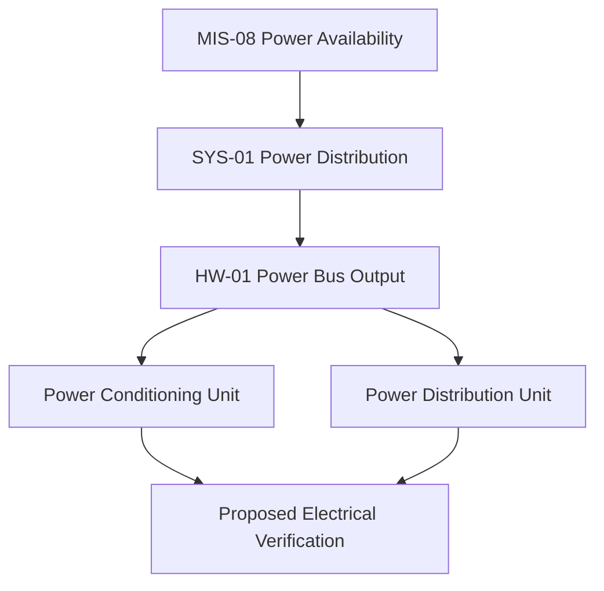

This example illustrates a proposed engineering
association rather than a formally verified
SysML allocation.

### Candidate Association Coverage

| Traceability Category | Associated | Total | Coverage |
|---|---:|---:|---:|
| Mission to subsystem | 12 | 12 | 100% |
| Subsystem to hardware | 25 | 32 | 78.125% |
| Hardware to component | 16 | 16 | 100% |

These metrics measure candidate association
coverage in supplementary documentation.

They include partial allocations and do not
establish complete end-to-end traceability
or verified requirement satisfaction.

### Open Hardware Allocations

Seven logical requirements lack sufficiently
direct hardware requirement associations.

| Requirement | Open Allocation |
|---|---|
| SYS-04 | Power monitoring hardware |
| SYS-08 | Propellant status measurement |
| SYS-12 | Thermal telemetry hardware |
| SYS-14 | Water recovery hardware |
| SYS-15 | Emergency backup hardware |
| SYS-18 | Guidance processing hardware |
| SYS-28 | Structural health monitoring hardware |

Four payload subsystem requirements also lack
a dedicated science-related mission parent
in the proposed traceability matrix.

[Complete Requirements Traceability Matrix](docs/traceability_matrix.md)

## 11. Subsystem Interface Engineering

The supplementary interface documentation
organizes potential exchanges among the
functional and hardware subsystems.

| Interface Category | Engineering Focus |
|---|---|
| Electrical | Electrical power and distribution |
| Data | Telemetry and scientific information |
| Command and Control | Operational commands and actuator instructions |
| Mechanical | Mounting, docking, and structural loads |
| Thermal | Heat transfer and temperature control |
| Fluid | Fluid handling and transport |

### Interface Documentation Deliverables

| Deliverable | Count |
|---|---:|
| Subsystems reviewed | 8 |
| Preliminary logical interface entries | 16 |
| Requirement-driven interface candidates | 10 |
| Example interface control records | 3 |
| Interface modeling gaps | 11 |

### Example Preliminary Interface Records

| Interface | Potential Exchanged Item | Proposed Direction |
|---|---|---|
| Power-GNC | DC electrical power | Power to GNC |
| GNC-Propulsion | Maneuver guidance commands | GNC to Propulsion |
| Payload-Communication | Scientific data | Payload to Communication |

Electrical parameters, communication protocols,
timing constraints, and acceptance criteria
remain subject to further definition.

The interface register is supplementary
engineering documentation, not an approved
Interface Control Document.

[Complete Subsystem Interface Documentation](docs/subsystem_interfaces.md)

## 12. Model Consistency and Engineering Review

The architecture review identifies opportunities
for improving the original exported models.

Selected observations include:

- Reused original requirement identifiers.
- Incomplete logical-to-hardware allocations.
- Undefined connector directions and exchanged items.
- Incomplete electrical interface specifications.
- Potential overlap in GNC sensor representation.
- RF and mechanical antenna interfaces requiring clarification.
- Missing thermal control connections.
- Missing environmental monitoring components.
- Structural health monitoring allocation gaps.
- Missing dedicated science mission requirements.
- Undefined quantitative acceptance criteria.
- Incomplete vehicle-specific subsystem allocations.

The consolidated documentation contains
12 architecture review findings and
19 unresolved requirement parameter groups.

### Unresolved Propulsion Parameters

| Parameter | Description | Status |
|---|---|---|
| D | Minimum total impulse | TBD |
| E | Minimum adjustable thrust percentage | TBD |
| F | Maximum commandable thrust resolution percentage | TBD |

No unsupported numerical values are assigned.

[Model Consistency and Verification Report](docs/verification.md)

## 13. Verification Planning

The project includes proposed verification
methods for all documented requirements.

| Verification Method | Purpose |
|---|---|
| Inspection | Review design documentation and physical characteristics |
| Analysis | Evaluate performance using engineering calculations or simulations |
| Demonstration | Observe intended functional behavior |
| Test | Measure behavior against defined acceptance criteria |

### Verification Planning Summary

| Requirement Level | Documented | Proposed Verification Methods |
|---|---:|---:|
| Mission | 12 | 12 |
| Logical subsystem | 32 | 32 |
| Technology hardware | 16 | 16 |
| Total | 60 | 60 |

The documentation provides proposed
verification methods for all 60 requirements.

No demonstrated requirement compliance
has been established through this review.

### Verification Status

| Activity | Status |
|---|---|
| Original diagram inventory | Completed |
| Requirements inventory review | Completed |
| Qualified identifier review | Completed |
| Supplementary traceability assessment | Completed |
| Interface documentation review | Completed |
| Proposed verification planning | Completed |
| Formal editable-model verification | Not performed |
| Quantitative mission analysis | Not performed |
| Physical hardware testing | Not performed |
| Flight qualification | Not performed |

## 14. Technologies and Engineering Skills

| Technology or Method | Application |
|---|---|
| Gaphor | Visual system modeling |
| SysML | Systems architecture representation |
| MBSE | Structured systems engineering |
| BDD | System and subsystem decomposition |
| IBD | Internal subsystem relationships |
| Requirement diagrams | Requirement representation |
| Refine relationships | Requirement clarification |
| Satisfy relationships | Intended design satisfaction |
| RTM | Supplementary requirements traceability |
| Interface engineering | Subsystem interaction analysis |
| Verification planning | Proposed requirement assessment methods |
| Mermaid | Supplementary architecture illustrations |
| Markdown | Technical documentation |
| GitHub | Engineering artifact organization |

### Engineering Competencies Demonstrated

- System-of-systems architecture.
- Functional and hardware decomposition.
- Requirements engineering.
- Requirements identification and management.
- Subsystem interface analysis.
- Electrical power architecture.
- Communication and control architecture.
- Requirements traceability.
- Engineering gap identification.
- Verification and validation planning.
- Technical documentation.
- Engineering artifact management.

## 15. Original Artifact Inventory

| Artifact Category | Count |
|---|---:|
| Block Definition Diagrams | 4 |
| Internal Block Diagrams | 11 |
| Requirements-related diagrams | 18 |
| Total original SysML exports | 33 |
| PNG previews derived from original exports | 7 |
| Original project report | 1 |
| Supplementary technical documentation files | 6 |

The PNG previews are direct conversions of
selected original PDF diagrams.

They are not additional independent SysML models.

The original project report and diagram exports
are preserved separately from the supplementary
engineering documentation.

## 16. Repository Structure

```text
ARTEMIS-MISSION-AND-SPACECRAFT-ARCHITECTING-USING-GAPHOR-SysML-/
├── diagrams/
│   ├── concept_level/
│   │   └── Concept_level_BDD.pdf
│   ├── logical_level/
│   │   ├── Logical_BDD.pdf
│   │   ├── Logical_IBD.pdf
│   │   ├── Structure_BDD.pdf
│   │   └── Structure_IBD.pdf
│   ├── technology_level/
│   │   ├── Technology_BDD.pdf
│   │   ├── Technology_IBD.pdf
│   │   └── Eight subsystem IBD PDFs
│   ├── requirements/
│   │   ├── mission_level/
│   │   ├── subsystem_level/
│   │   └── hardware_level/
│   └── images/
│       └── Seven PNG diagram previews
├── docs/
│   ├── mission_overview.md
│   ├── system_architecture.md
│   ├── subsystem_interfaces.md
│   ├── requirements.md
│   ├── traceability_matrix.md
│   └── verification.md
├── ARTEMIS MISSION AND SPACECRAFT ARCHITECTING USING GAPHOR.pdf
├── LICENSE
└── README.md
```

## 17. Engineering Documentation

| Document | Description |
|---|---|
| [Mission Overview](docs/mission_overview.md) | Mission objectives, reference scenario, and architectural scope |
| [System Architecture](docs/system_architecture.md) | Concept, logical, and technology architecture |
| [Subsystem Interfaces](docs/subsystem_interfaces.md) | Preliminary interface register and integration dependencies |
| [Requirements Inventory](docs/requirements.md) | All 60 requirements and qualified identifiers |
| [Requirements Traceability Matrix](docs/traceability_matrix.md) | Proposed allocations, association coverage, and open requirements |
| [Verification Report](docs/verification.md) | Model observations, engineering gaps, and verification planning |

### Recommended Reading Order

1. Mission Overview.
2. System Architecture.
3. Subsystem Interfaces.
4. Requirements Inventory.
5. Requirements Traceability Matrix.
6. Verification Report.

## 18. Original Project Report

[Artemis Mission and Spacecraft Architecting Using Gaphor](ARTEMIS%20MISSION%20AND%20SPACECRAFT%20ARCHITECTING%20USING%20GAPHOR.pdf)

The original project report is retained as
a historical engineering artifact.

The supplementary documentation is based
primarily on the recovered SysML diagram exports.

## 19. Reproducing and Reviewing the Project

Clone the repository:

```bash
git clone https://github.com/ShanmukhJonnalagadda/ARTEMIS-MISSION-AND-SPACECRAFT-ARCHITECTING-USING-GAPHOR-SysML-.git
cd ARTEMIS-MISSION-AND-SPACECRAFT-ARCHITECTING-USING-GAPHOR-SysML-
```

Open the PDF diagrams using a compatible
PDF viewer.

Review the supplementary Markdown files
through GitHub or a Markdown editor.

Gaphor was used for the original SysML
modeling work.

However, the editable Gaphor source file
is not currently included in this repository.

The exported PDFs can be reviewed independently,
but they cannot reproduce the complete editable
model or its underlying semantic relationships.

## 20. Project Limitations

- The editable Gaphor source model is unavailable.
- Formal SysML semantic verification has not been performed.
- The complete original report has not been independently reviewed.
- The architecture represents an academic reference scenario.
- Vehicle-specific hardware allocations remain incomplete.
- Interface specifications require further development.
- Several requirement acceptance criteria remain undefined.
- Proposed traceability associations include partial allocations.
- Numerical performance analyses have not been established.
- Physical system integration has not been tested.
- No demonstrated requirement compliance is claimed.
- No official NASA approval or flight qualification is established.

## 21. Future Development

- Recover the editable Gaphor project.
- Review formal SysML relationships and semantics.
- Refine requirement statements and acceptance criteria.
- Complete open requirement allocations.
- Develop vehicle-specific system architecture.
- Define typed interfaces and exchanged items.
- Develop electrical power and energy budgets.
- Develop communication link budgets.
- Perform thermal and structural analyses.
- Model detailed mission behavior.
- Develop requirement-to-test-case relationships.
- Execute engineering verification activities.
- Record verification evidence and results.

## 22. Project Conclusion

This project demonstrates a structured application
of Model-Based Systems Engineering to a complex
System of Systems.

The original SysML artifacts represent mission
elements, functional subsystems, hardware
components, and engineering requirements across
three architectural levels.

The supplementary repository documentation
consolidates 60 requirements, introduces unique
identifiers, proposes traceability relationships,
identifies architecture and interface gaps,
and develops verification planning.

The project distinguishes original modeling work,
supplementary engineering interpretations,
and unverified design assumptions.

## License

See the [LICENSE](LICENSE) file for repository
licensing information.

## Author

Sai Shanmukhnath Jonnalagadda

[GitHub Profile](https://github.com/ShanmukhJonnalagadda)
