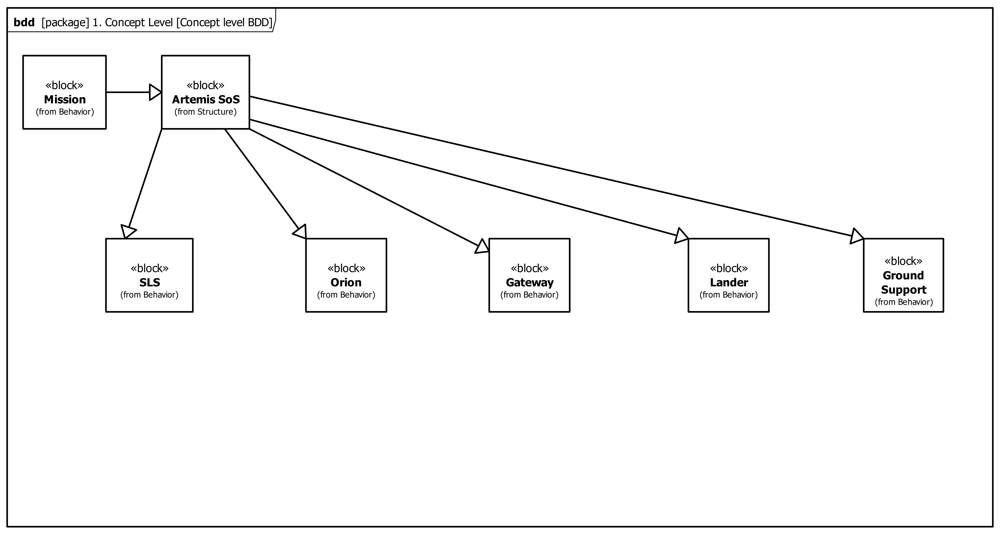
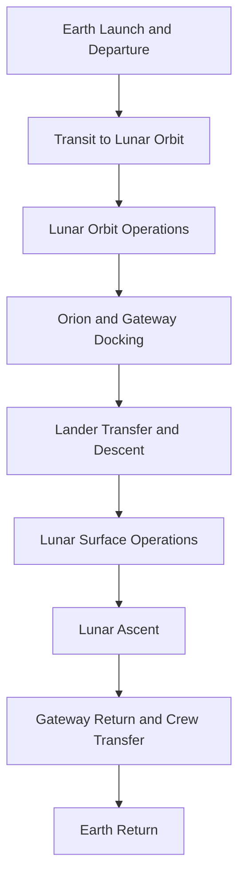
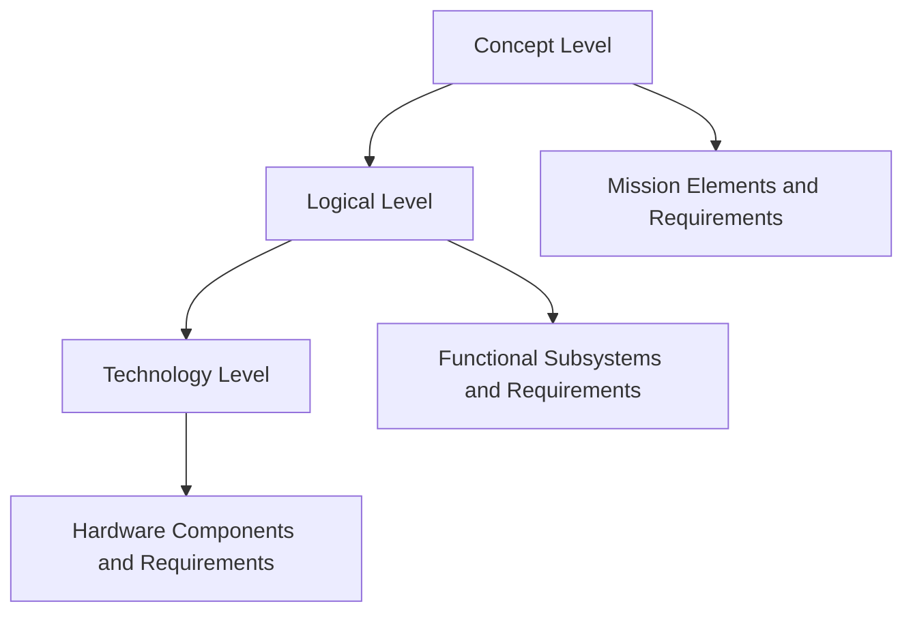
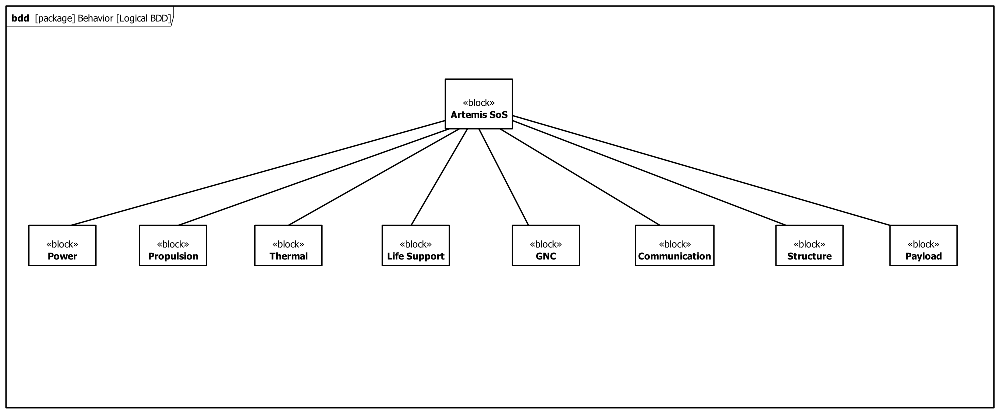
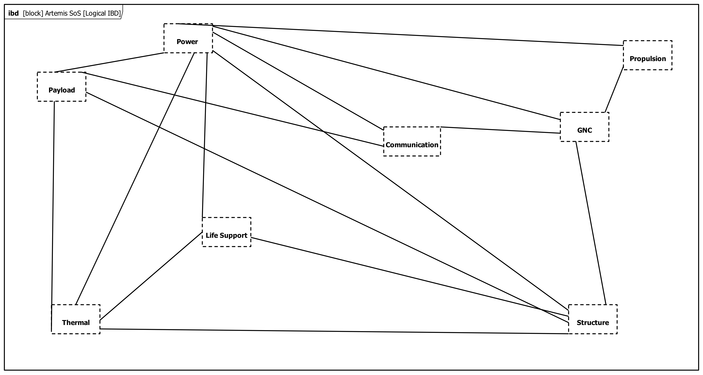
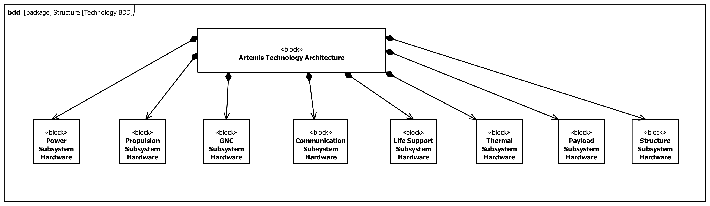
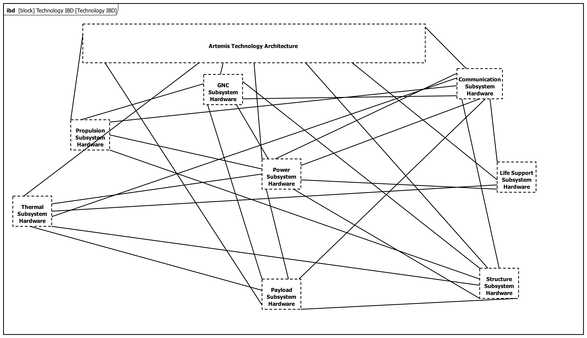
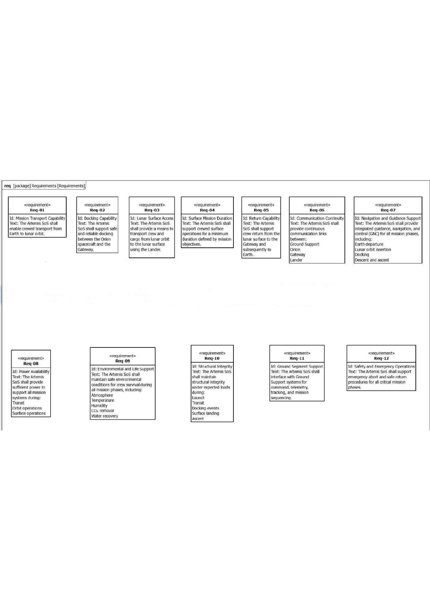

# Artemis Mission Overview

## 1. Project Introduction

This project presents an academic Model-Based Systems
Engineering (MBSE) study of the Artemis lunar exploration
mission using the Systems Modeling Language (SysML)
and Gaphor modeling environment.

The project represents Artemis as a System of Systems (SoS),
consisting of multiple mission elements, functional
subsystems, hardware components, and associated requirements.

The objective is to explore how a complex engineering
system can be organized, decomposed, represented,
and documented through structured system models.

This project is an academic reference architecture.
It is not an official NASA engineering model or a
flight-qualified spacecraft design.

## 2. Problem Statement

Complex space exploration missions require coordination
between transportation systems, spacecraft, ground support,
navigation, communication, power, environmental control,
and scientific payloads.

A structured systems engineering approach helps identify
functional responsibilities, subsystem dependencies,
hardware architecture, and requirement relationships.

This project applies SysML modeling techniques to represent
these engineering relationships across multiple levels
of system abstraction.

## 3. Project Objectives

- Represent Artemis as a System of Systems.
- Identify major mission elements and their responsibilities.
- Develop a concept-level system architecture.
- Decompose the system into eight logical subsystems.
- Represent internal subsystem relationships.
- Develop a technology-level hardware architecture.
- Document mission, subsystem, and hardware requirements.
- Represent selected refine and satisfy relationships.
- Establish a foundation for requirements traceability.
- Identify opportunities for further model verification.

## 4. System of Systems Architecture

The concept-level Block Definition Diagram identifies
five major elements within the Artemis architecture.

| Mission Element | Intended Role in the Reference Architecture |
|---|---|
| Space Launch System (SLS) | Launch and mission transportation support |
| Orion | Crewed spacecraft transportation |
| Gateway | Lunar orbital support and docking |
| Lander | Transportation between lunar orbit and the surface |
| Ground Support | Command, telemetry, tracking, and mission coordination |

These descriptions provide an engineering interpretation
of the mission elements represented in the concept model.

The Gateway-based architecture is the scenario adopted
by this academic study. It should not be interpreted
as the configuration of every Artemis mission.

[Original Concept Level BDD](../diagrams/concept_level/Concept_level_BDD.pdf)

## 5. Reference Mission Scenario

The mission requirements describe crew transportation
from Earth to lunar orbit, docking, lunar surface access,
surface operations, and crew return.

The following sequence is an explanatory interpretation
of those documented requirements.

This diagram is a supplementary mission overview.
It is not an original exported Gaphor behavior model.

Exact mission sequencing, orbital parameters,
mission durations, and operational timelines
are not established by this overview.

## 6. Mission Phases

| Phase | Intended Function | Relevant Engineering Considerations |
|---|---|---|
| Launch | Depart Earth | Propulsion, structure, power, safety |
| Transit | Transport crew toward lunar orbit | Navigation, communication, life support |
| Lunar orbit | Support orbital operations | Guidance, propulsion, communication |
| Docking | Connect mission elements | Navigation, structural interfaces |
| Descent | Access the lunar surface | Guidance, propulsion, structural support |
| Surface operations | Support crew and scientific activities | Power, thermal control, life support, payload |
| Ascent | Return crew to lunar orbit | Propulsion, guidance, communication |
| Earth return | Support crew return to Earth | Navigation, life support, emergency operations |

The engineering considerations are explanatory
allocations derived from the modeled mission functions.

They are not verified operational procedures.

## 7. Three-Level Architecture Methodology

The project organizes the Artemis architecture
across three levels of abstraction.

### Concept Level

The concept level identifies the overall mission
system and its major participating elements.

This level establishes the high-level system scope.

### Logical Level

The logical level identifies eight functional
subsystems and their relationships.

This level emphasizes functional responsibilities
and interactions rather than detailed hardware
specifications.

### Technology Level

The technology level represents hardware-oriented
subsystem architecture and internal components.

This level provides a foundation for more detailed
hardware allocation and interface development.

## 8. Logical Subsystem Architecture

The logical architecture identifies eight
major functional subsystems.

| Subsystem | Functional Responsibility |
|---|---|
| Power | Electrical energy generation, storage, and distribution |
| Propulsion | Thrust generation and maneuvering support |
| Thermal | Temperature regulation and heat management |
| Life Support | Crew environmental support |
| GNC | Guidance, navigation, and control |
| Communication | Command and telemetry exchange |
| Structure | Mechanical support and structural interfaces |
| Payload | Scientific instrumentation and data handling |

The logical Internal Block Diagram represents
relationships among these functional subsystems.

The connectors identify modeled relationships.
Detailed interface specifications, signal direction,
and quantitative flow properties require further
definition.

## 9. Technology Architecture

The technology architecture represents hardware
subsystems corresponding to the eight logical
functional areas.

The Technology IBD represents hardware-level
subsystem interconnections.

The hardware architecture is conceptual.

It does not establish final component selection,
electrical specifications, physical dimensions,
or flight qualification.

## 10. Mission-Level Requirements

The original mission requirements diagram contains
12 documented requirements.

| Original ID | Requirement Title | Summary |
|---|---|---|
| Req-01 | Mission Transport Capability | Enable crewed transport from Earth to lunar orbit |
| Req-02 | Docking Capability | Support docking between Orion and Gateway |
| Req-03 | Lunar Surface Access | Transport crew and cargo from lunar orbit to the surface |
| Req-04 | Surface Mission Duration | Support crewed surface operations for the required duration |
| Req-05 | Return Capability | Support crew return from the lunar surface to Gateway and subsequently Earth |
| Req-06 | Communication Continuity | Support communication between Ground Support, Orion, Gateway, and Lander |
| Req-07 | Navigation and Guidance Support | Provide integrated GNC throughout mission phases |
| Req-08 | Power Availability | Provide sufficient power during mission operations |
| Req-09 | Environmental and Life Support | Maintain environmental conditions required for crew survival |
| Req-10 | Structural Integrity | Maintain structural integrity under expected mission loads |
| Req-11 | Ground Segment Support | Support command, telemetry, tracking, and mission sequencing |
| Req-12 | Safety and Emergency Operations | Support emergency abort and safe-return procedures |

The table summarizes the original requirement statements.

The original SysML diagram remains the reference
for the complete requirement wording.

[Original Mission Requirements PDF](../diagrams/requirements/mission_level/Requirements.pdf)

## 11. Requirements Engineering Scope

The recovered SysML exports contain 60 documented
requirements across three architectural levels.

| Requirement Level | Count |
|---|---:|
| Mission-level requirements | 12 |
| Logical subsystem requirements | 32 |
| Technology hardware requirements | 16 |
| Total | 60 |

The subsystem requirements include four requirements
for each of the eight functional subsystems.

The hardware requirements include two requirements
for each of the eight hardware subsystems.

Requirement identifiers are reused across the
architectural levels.

Future traceability documentation should distinguish
these levels through unique qualified identifiers
while preserving the original requirement labels.

## 12. Requirements Relationships

The original requirements relationship diagram
includes refine and satisfy relationships between
mission requirements and subsystem blocks.

The modeled relationships provide information
about intended connections between requirements
and engineering design elements.

A satisfy relationship represents an intended
design allocation. It does not independently
demonstrate that a requirement has been verified.

Complete requirement-to-test traceability and
quantitative acceptance criteria require
additional engineering development.

[Original Requirements Relationship Diagram](../diagrams/requirements/mission_level/Requirements%20with%20refine%20and%20satisfy%20links.pdf)

## 13. Modeling Tools and Methods

| Tool or Method | Application |
|---|---|
| Gaphor | Visual systems modeling |
| SysML | System architecture and requirements representation |
| MBSE | Structured model-based engineering approach |
| Block Definition Diagram | System and subsystem structure |
| Internal Block Diagram | Internal relationships and interfaces |
| Requirement Diagram | Requirement identification and relationships |
| GitHub | Engineering artifact organization and documentation |
| Markdown | Supporting technical documentation |

## 14. Preserved Engineering Artifacts

The repository preserves the original project report
and 33 exported SysML diagrams.

| Artifact Category | Count |
|---|---:|
| Concept-level architecture diagrams | 1 |
| Logical-level architecture diagrams | 4 |
| Technology-level architecture diagrams | 10 |
| Mission-level requirements diagrams | 2 |
| Subsystem-level requirements diagrams | 8 |
| Hardware-level requirements diagrams | 8 |
| Total original diagram exports | 33 |

Seven PNG previews were subsequently generated
from selected original PDF exports to improve
repository accessibility and presentation.

The original PDF diagrams remain unchanged.

## 15. Engineering Scope and Limitations

This academic project focuses on system architecture
and requirements representation.

The available repository artifacts do not establish:

- Official NASA architecture approval.
- Flight-qualified hardware designs.
- Complete executable mission simulations.
- Verified orbital trajectories.
- Quantitative mass or power budgets.
- Validated communication link budgets.
- Complete electrical interface specifications.
- Verified thermal or structural performance.
- Demonstrated satisfaction of all requirements.
- Formal consistency checking of the editable model.

The editable Gaphor source model is not currently
available in the repository.

Several requirement acceptance parameters remain
undefined and require further engineering work.

## 16. Future Development

Potential extensions include:

- Recovering the editable Gaphor project.
- Defining unique requirement identifiers.
- Completing requirement-to-component allocations.
- Adding measurable acceptance criteria.
- Defining interface directions and exchanged items.
- Developing interface control documentation.
- Modeling detailed mission behavior.
- Developing power, communication, and thermal budgets.
- Performing formal model consistency checks.
- Establishing requirement verification methods.

These extensions are proposed future activities
rather than completed engineering work.

## 17. Original Project Documentation

[Artemis Mission and Spacecraft Architecting Using Gaphor](../ARTEMIS%20MISSION%20AND%20SPACECRAFT%20ARCHITECTING%20USING%20GAPHOR.pdf)

The original report and exported SysML diagrams
are retained as historical project artifacts.

This mission overview is supplementary documentation
organized around the recovered diagram exports.

## 18. Conclusion

The Artemis architecture project demonstrates
the application of model-based systems engineering
to a complex System of Systems.

The project organizes mission elements, functional
subsystems, hardware architecture, and engineering
requirements through multiple SysML viewpoints.

The recovered models provide a foundation for
architecture analysis, interface development,
requirements traceability, and future system
verification activities.
