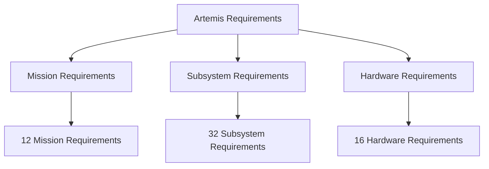
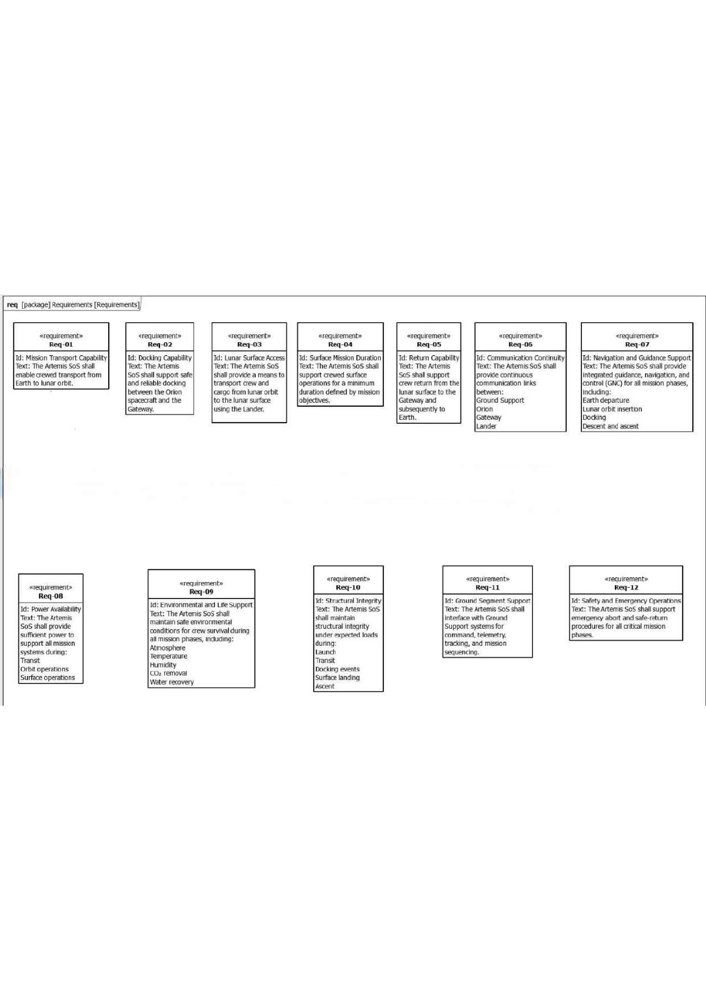

# Artemis Requirements Engineering

## 1. Introduction

This document establishes a consolidated requirements
inventory for the academic Artemis System of Systems
architecture developed using Gaphor and SysML.

The original exported diagrams contain 60 requirements
distributed across mission, logical subsystem, and
technology hardware levels.

This inventory preserves the original requirement
identifiers and titles while introducing unique
qualified identifiers for supplementary documentation
and requirements traceability.

The requirement descriptions below summarize the
original statements. The original PDF diagrams remain
the reference for their complete wording.

These are academic project requirements, not an
official NASA requirements baseline.

## 2. Requirements Engineering Objectives

- Consolidate the original requirements.
- Establish unique requirement identifiers.
- Preserve original requirement references.
- Organize requirements by architectural level.
- Identify subsystem ownership.
- Identify missing acceptance criteria.
- Establish a foundation for requirements traceability.
- Support future verification planning.

## 3. Requirements Hierarchy

This supplementary diagram summarizes the
requirements inventory rather than verified
parent-child derivation relationships.

| Requirement Level | Count |
|---|---:|
| Mission | 12 |
| Logical subsystem | 32 |
| Technology hardware | 16 |
| Total | 60 |

## 4. Requirement Identification Convention

The original requirement diagrams reuse numerical
identifiers across architectural levels.

For example, Req-01 appears in the mission,
power subsystem, and power hardware diagrams.

The following qualified identification convention
is introduced to avoid ambiguity.

| Prefix | Architectural Level | Identifier Range |
|---|---|---|
| MIS | Mission | MIS-01 to MIS-12 |
| SYS | Logical subsystem | SYS-01 to SYS-32 |
| HW | Technology hardware | HW-01 to HW-16 |

Example:

| Original ID | Source Level | Qualified ID |
|---|---|---|
| Req-01 | Mission | MIS-01 |
| Req-01 | Power subsystem | SYS-01 |
| Req-01 | Power hardware | HW-01 |

The qualified identifiers are supplementary
documentation identifiers.

The original SysML exports have not been modified.

## 5. Mission-Level Requirements

| Qualified ID | Original ID | Requirement Title | Requirement Summary |
|---|---|---|---|
| MIS-01 | Req-01 | Mission Transport Capability | Enable crewed transport from Earth to lunar orbit |
| MIS-02 | Req-02 | Docking Capability | Support safe and reliable docking between Orion and Gateway |
| MIS-03 | Req-03 | Lunar Surface Access | Transport crew and cargo from lunar orbit to the lunar surface using the lander |
| MIS-04 | Req-04 | Surface Mission Duration | Support crewed surface operations for a minimum duration defined by mission objectives |
| MIS-05 | Req-05 | Return Capability | Support crew return from the lunar surface to Gateway and subsequently Earth |
| MIS-06 | Req-06 | Communication Continuity | Provide continuous communication between Ground Support, Orion, Gateway, and Lander |
| MIS-07 | Req-07 | Navigation and Guidance Support | Provide integrated GNC during mission phases, including Earth departure, lunar orbit insertion, docking, descent, and ascent |
| MIS-08 | Req-08 | Power Availability | Provide sufficient electrical power during transit, orbit, and surface operations |
| MIS-09 | Req-09 | Environmental and Life Support | Maintain environmental conditions necessary for crew survival |
| MIS-10 | Req-10 | Structural Integrity | Maintain structural integrity under expected mission loads |
| MIS-11 | Req-11 | Ground Segment Support | Interface with Ground Support for command, telemetry, tracking, and mission sequencing |
| MIS-12 | Req-12 | Safety and Emergency Operations | Support emergency abort and safe-return procedures during critical mission phases |

Source:

[Original Mission Requirements](../diagrams/requirements/mission_level/Requirements.pdf)

## 6. Logical Subsystem Requirements

The logical requirements inventory contains
four requirements for each of the eight
functional subsystems.

### 6.1 Power Subsystem

| Qualified ID | Original ID | Requirement Title | Requirement Summary |
|---|---|---|---|
| SYS-01 | Req-01 | Power Distribution | Provide continuous electrical power to subsystems during all modeled mission phases |
| SYS-02 | Req-02 | Peak Power Handling | Support peak loads during communication bursts, propulsion burns, and life-support surges |
| SYS-03 | Req-03 | Power Storage | Store sufficient energy for operations without solar generation |
| SYS-04 | Req-04 | Power Monitoring | Provide voltage, current, and state-of-charge telemetry to Communication |

Source:

[Power Subsystem Requirements](../diagrams/requirements/subsystem_level/Power_Subsystem.pdf)

### 6.2 Propulsion Subsystem

| Qualified ID | Original ID | Requirement Title | Requirement Summary |
|---|---|---|---|
| SYS-05 | Req-05 | Orbital Maneuvering | Provide thrust for orbital insertion, correction burns, rendezvous, and deorbit maneuvers |
| SYS-06 | Req-06 | Attitude Jet Support | Provide auxiliary thruster support for attitude maneuvers commanded by GNC |
| SYS-07 | Req-07 | Safe Throttle Control | Maintain stable thrust response within defined throttle ranges |
| SYS-08 | Req-08 | Propellant Status Telemetry | Provide real-time propellant level telemetry to Communication |

Source:

[Propulsion Subsystem Requirements](../diagrams/requirements/subsystem_level/Propulsion_Subsystem.pdf)

### 6.3 Thermal Subsystem

| Qualified ID | Original ID | Requirement Title | Requirement Summary |
|---|---|---|---|
| SYS-09 | Req-09 | Temperature Regulation | Maintain subsystem temperatures within allowable limits during mission phases |
| SYS-10 | Req-10 | Crew Cabin Temperature | Maintain a habitable temperature range for crewed segments |
| SYS-11 | Req-11 | Heat Dissipation | Dissipate heat generated by payload instruments, avionics, and propulsion components |
| SYS-12 | Req-12 | Thermal Telemetry | Provide surface, cabin, and equipment temperature telemetry |

Source:

[Thermal Subsystem Requirements](../diagrams/requirements/subsystem_level/Thermal_Subsystem.pdf)

### 6.4 Life Support Subsystem

| Qualified ID | Original ID | Requirement Title | Requirement Summary |
|---|---|---|---|
| SYS-13 | Req-13 | Atmosphere Control | Maintain safe oxygen, carbon dioxide, humidity, and pressure levels |
| SYS-14 | Req-14 | Water Recovery | Recycle and store water required for crew survival |
| SYS-15 | Req-15 | Emergency Backup Mode | Provide emergency operation for a minimum duration defined by mission needs |
| SYS-16 | Req-16 | Environmental Metrics Telemetry | Broadcast environmental sensor data to Communication |

Source:

[Life Support Subsystem Requirements](../diagrams/requirements/subsystem_level/Life_Support_Subsystem.pdf)

### 6.5 Guidance, Navigation, and Control

| Qualified ID | Original ID | Requirement Title | Requirement Summary |
|---|---|---|---|
| SYS-17 | Req-17 | Navigation | Estimate spacecraft position, velocity, and attitude using integrated inertial and optical sensors |
| SYS-18 | Req-18 | Guidance Command | Generate maneuver guidance for propulsion during mission stages |
| SYS-19 | Req-19 | Attitude Control | Provide attitude stabilization using reaction wheels and/or thrusters |
| SYS-20 | Req-20 | Sensor Fusion | Integrate IMU, star tracker, gyroscope, accelerometer, and GPS data |

Source:

[GNC Subsystem Requirements](../diagrams/requirements/subsystem_level/GNC_Subsystem.pdf)

### 6.6 Communication Subsystem

| Qualified ID | Original ID | Requirement Title | Requirement Summary |
|---|---|---|---|
| SYS-21 | Req-21 | Continuous Link | Maintain bidirectional communication between spacecraft, lunar assets, and Ground Support |
| SYS-22 | Req-22 | High-Gain Operations | Support high-gain transmission during long-range communication |
| SYS-23 | Req-23 | Telemetry Routing | Route subsystem telemetry to Ground Support |
| SYS-24 | Req-24 | Command Handling | Receive, authenticate, and forward commands to connected subsystems |

Source:

[Communication Subsystem Requirements](../diagrams/requirements/subsystem_level/Communications_Subsystem.pdf)

### 6.7 Structure Subsystem

| Qualified ID | Original ID | Requirement Title | Requirement Summary |
|---|---|---|---|
| SYS-25 | Req-25 | Load Bearing | Maintain structural integrity under launch, transit, landing, docking, ascent, and surface loads |
| SYS-26 | Req-26 | Subsystem Mounting | Provide mounting interfaces for subsystems and payloads |
| SYS-27 | Req-27 | Safety Interfaces | Support docking, landing gear attachment, and thermal interface points |
| SYS-28 | Req-28 | Structural Health Monitoring | Monitor and relay stress, vibration, and structural condition data |

Source:

[Structure Subsystem Requirements](../diagrams/requirements/subsystem_level/Structure_Subsystem.pdf)

### 6.8 Payload Subsystem

| Qualified ID | Original ID | Requirement Title | Requirement Summary |
|---|---|---|---|
| SYS-29 | Req-29 | Scientific Data Collection | Collect scientific measurement data during transit, orbit, and surface operations |
| SYS-30 | Req-30 | Data Transfer | Transfer scientific data to the Payload Data Handling Unit for storage and downlink |
| SYS-31 | Req-31 | Instrument Thermal Support | Interface with Thermal to maintain instrument temperatures |
| SYS-32 | req-32 | Operational Mode Control | Receive operational mode commands from Communication |

Source:

[Payload Subsystem Requirements](../diagrams/requirements/subsystem_level/Payload_Subsystem.pdf)

## 7. Technology Hardware Requirements

The technology requirements inventory contains
two requirements for each hardware subsystem.

### 7.1 Power Hardware

| Qualified ID | Original ID | Requirement Title | Requirement Summary |
|---|---|---|---|
| HW-01 | Req -01 | Power Bus Output | Provide a regulated DC power bus to spacecraft subsystems |
| HW-02 | Req -02 | Energy Storage | Include energy storage capable of supporting loads during eclipse periods |

Source:

[Power Hardware Requirements](../diagrams/requirements/hardware_level/Power_Subsystem_Hardware.pdf)

### 7.2 Propulsion Hardware

| Qualified ID | Original ID | Requirement Title | Requirement Summary |
|---|---|---|---|
| HW-03 | Req-03 | Total Impulse Capability | Provide total impulse of at least D N·s for nominal orbital maneuvers and contingency delta-V |
| HW-04 | Req-04 | Thrust Range and Control | Provide adjustable thrust from E% to 100% of rated thrust with commandable resolution no greater than F% |

The parameters D, E, and F are unresolved
in the original requirement statements.

Source:

[Propulsion Hardware Requirements](../diagrams/requirements/hardware_level/Propulsion_Subsystem_Hardware.pdf)

### 7.3 GNC Hardware

| Qualified ID | Original ID | Requirement Title | Requirement Summary |
|---|---|---|---|
| HW-05 | Req-05 | Attitude Determination Accuracy | Determine spacecraft attitude using IMU and star tracking sensors |
| HW-06 | Req-06 | Attitude Control Actuation | Provide control torque using reaction wheels or RCS thrusters |

Source:

[GNC Hardware Requirements](../diagrams/requirements/hardware_level/GNC_Subsystem_Hardware.pdf)

### 7.4 Communication Hardware

| Qualified ID | Original ID | Requirement Title | Requirement Summary |
|---|---|---|---|
| HW-07 | Req-07 | Telemetry and Command Link | Support continuous telemetry and command communication with ground systems |
| HW-08 | Req-08 | Antenna Support | Include high-gain and low-gain antenna systems for near-field and deep-space links |

The terminology follows the original requirement.
The intended meaning of near-field communication
requires further clarification.

Source:

[Communication Hardware Requirements](../diagrams/requirements/hardware_level/Communication_Hardware.pdf)

### 7.5 Life Support Hardware

| Qualified ID | Original ID | Requirement Title | Requirement Summary |
|---|---|---|---|
| HW-09 | Req-09 | Atmosphere Regulation | Maintain a breathable cabin atmosphere with appropriate oxygen, carbon dioxide, humidity, and pressure |
| HW-10 | Req-10 | Environmental Monitoring | Include sensors for air quality, pressure, and temperature monitoring |

Source:

[Life Support Hardware Requirements](../diagrams/requirements/hardware_level/Life_Support_Hardware.pdf)

### 7.6 Thermal Hardware

| Qualified ID | Original ID | Requirement Title | Requirement Summary |
|---|---|---|---|
| HW-11 | Req-11 | Heat Rejection | Include radiators sufficient to reject heat generated by spacecraft equipment |
| HW-12 | Req-12 | Thermal Protection | Include insulation and heaters to maintain components within allowable limits |

Source:

[Thermal Hardware Requirements](../diagrams/requirements/hardware_level/Thermal_Subsystem_Hardware.pdf)

### 7.7 Payload Hardware

| Qualified ID | Original ID | Requirement Title | Requirement Summary |
|---|---|---|---|
| HW-13 | Req-13 | Science Instrument Operation | Collect scientific data using cameras, spectrometers, or sensors |
| HW-14 | Req-14 | Payload Data Management | Store and transmit scientific data to Communication |

Source:

[Payload Hardware Requirements](../diagrams/requirements/hardware_level/Payload_Hardware.pdf)

### 7.8 Structure Hardware

| Qualified ID | Original ID | Requirement Title | Requirement Summary |
|---|---|---|---|
| HW-15 | Req-15 | Load-Bearing Support | Provide mounting interfaces and support for spacecraft subsystems |
| HW-16 | Req-16 | Structural Integrity | Withstand launch, docking, and operational mechanical loads |

Source:

[Structure Hardware Requirements](../diagrams/requirements/hardware_level/Structure_Subsystem_Hardware.pdf)

## 8. Requirements Distribution

| Subsystem | Logical Requirements | Hardware Requirements | Total |
|---|---:|---:|---:|
| Power | 4 | 2 | 6 |
| Propulsion | 4 | 2 | 6 |
| Thermal | 4 | 2 | 6 |
| Life Support | 4 | 2 | 6 |
| GNC | 4 | 2 | 6 |
| Communication | 4 | 2 | 6 |
| Structure | 4 | 2 | 6 |
| Payload | 4 | 2 | 6 |
| Total | 32 | 16 | 48 |

Together with 12 mission requirements,
the consolidated inventory contains
60 requirement entries.

## 9. Original Requirements Relationships

The original mission requirements relationship
diagram contains refine and satisfy relationships
between mission requirements and subsystem blocks.

A refine relationship provides additional
detail or clarification of a requirement.

A satisfy relationship expresses the intended
satisfaction of a requirement by a design element.

Neither relationship independently demonstrates
successful requirement verification.

Source:

[Original Refine and Satisfy Relationships](../diagrams/requirements/mission_level/Requirements%20with%20refine%20and%20satisfy%20links.pdf)

Complete mission-to-subsystem and subsystem-to-hardware
allocations require further review.

## 10. Requirements Quality Criteria

The following criteria are proposed for
future requirements quality assessment.

| Criterion | Description |
|---|---|
| Unique | Requirement has an unambiguous identifier |
| Clear | Requirement has an understandable meaning |
| Necessary | Requirement supports a defined engineering objective |
| Atomic | Requirement expresses a distinct obligation |
| Feasible | Requirement is achievable within system constraints |
| Measurable | Requirement has defined acceptance criteria |
| Traceable | Requirement connects to relevant parent and design elements |
| Verifiable | Requirement can be assessed using an appropriate method |

The qualified identifiers improve identification
within this documentation.

They do not resolve every ambiguity or establish
formal requirements quality compliance.

## 11. Unresolved Requirement Parameters

The following items require further engineering
definition before quantitative verification.

| Gap ID | Requirement References | Unresolved Parameter |
|---|---|---|
| RQG-01 | MIS-04 | Minimum surface mission duration |
| RQG-02 | MIS-06, SYS-21, HW-07 | Communication availability and allowable outage duration |
| RQG-03 | MIS-08, SYS-01, HW-01 | Required bus voltage, power demand, and tolerances |
| RQG-04 | SYS-02 | Maximum peak load and duration |
| RQG-05 | SYS-03, HW-02 | Energy storage capacity and eclipse duration |
| RQG-06 | SYS-07, HW-03, HW-04 | Total impulse D, minimum thrust E, and resolution F |
| RQG-07 | SYS-09, SYS-10, HW-12 | Allowable equipment and cabin temperature ranges |
| RQG-08 | SYS-11, HW-11 | Heat rejection capacity |
| RQG-09 | SYS-13, HW-09 | Atmospheric acceptance limits |
| RQG-10 | SYS-14 | Water recovery capacity and storage requirements |
| RQG-11 | SYS-15 | Emergency backup duration |
| RQG-12 | SYS-17, HW-05 | Navigation and attitude accuracy |
| RQG-13 | SYS-19, HW-06 | Attitude stabilization and actuator performance limits |
| RQG-14 | SYS-22, HW-08 | Antenna gain, link range, and frequency requirements |
| RQG-15 | SYS-23, SYS-24 | Telemetry timing, data integrity, and command authentication criteria |
| RQG-16 | MIS-10, SYS-25, HW-16 | Mechanical load cases and structural acceptance limits |
| RQG-17 | SYS-28 | Structural monitoring accuracy and sampling requirements |
| RQG-18 | SYS-29, SYS-30, HW-13, HW-14 | Instrument performance, storage capacity, and data transfer rates |
| RQG-19 | MIS-12 | Emergency scenarios and safe-return acceptance criteria |

All unresolved numerical parameters remain TBD.

No unsupported engineering performance
values are introduced.

## 12. Proposed Requirement Verification Methods

| Method | Description |
|---|---|
| Inspection | Review design documents, models, and physical characteristics |
| Analysis | Evaluate requirements through engineering calculations or simulations |
| Demonstration | Observe functional behavior under defined conditions |
| Test | Measure actual system behavior against acceptance criteria |

### Example Verification Planning

| Requirement | Proposed Method | Required Acceptance Criteria |
|---|---|---|
| MIS-01 | Analysis | Defined mission transportation capability |
| MIS-02 | Demonstration and test | Defined docking performance and interface limits |
| SYS-01 | Analysis and test | Required electrical load and voltage limits |
| SYS-13 | Test | Defined atmospheric operating ranges |
| SYS-17 | Analysis and test | Navigation accuracy limits |
| SYS-24 | Test | Defined authentication and command forwarding behavior |
| HW-02 | Analysis and test | Required energy capacity and operating duration |
| HW-05 | Test | Quantified attitude determination accuracy |
| HW-11 | Analysis and test | Defined heat rejection requirements |
| HW-16 | Analysis and test | Defined mechanical load cases |

These verification methods are proposed.

The tests, demonstrations, and quantitative
analyses have not been performed as part
of this requirements inventory.

## 13. Requirements Management Record

Future requirements management should include
the following attributes.

| Attribute | Purpose |
|---|---|
| Qualified ID | Unique documentation identifier |
| Original ID | Reference to the original SysML requirement |
| Requirement Title | Descriptive requirement name |
| Requirement Statement | Complete requirement text |
| Source | Original model or document |
| Parent Requirement | Associated higher-level requirement |
| Allocated Element | Responsible subsystem or hardware component |
| Rationale | Reason for the requirement |
| Acceptance Criteria | Measurable conditions for verification |
| Verification Method | Inspection, analysis, demonstration, or test |
| Verification Evidence | Associated results and supporting records |
| Verification Status | Current verification state |
| Revision | Requirement change history |

The current inventory establishes identification,
source references, and functional ownership.

Complete parent allocations, acceptance criteria,
and verification evidence require further work.

## 14. Requirements Status Summary

| Inventory Category | Count | Status |
|---|---:|---|
| Mission requirements | 12 | Documented |
| Logical subsystem requirements | 32 | Documented |
| Technology hardware requirements | 16 | Documented |
| Total original requirements inventoried | 60 | Documented |
| Qualified documentation identifiers | 60 | Assigned |
| Requirements with demonstrated compliance in this review | 0 | Not verified |

Inventory completion must not be confused
with requirement satisfaction or verification.

The available artifacts establish the existence
of documented requirements, not physical
spacecraft compliance.

## 15. Requirements Engineering Limitations

- The editable Gaphor source model is unavailable.
- Original requirement identifiers are reused
  across architectural levels.
- Qualified identifiers exist in supplementary
  documentation rather than the original model.
- Several requirements contain undefined limits.
- Some requirements combine multiple obligations.
- Complete parent-child allocations are not established.
- Vehicle-specific allocations require further definition.
- Proposed verification methods remain unexecuted.
- No flight qualification evidence has been established.
- The requirements are not an official NASA baseline.

## 16. Supporting Documentation

- [Mission Overview](mission_overview.md)
- [System Architecture](system_architecture.md)
- [Subsystem Interfaces](subsystem_interfaces.md)
- [Mission Requirements](../diagrams/requirements/mission_level/Requirements.pdf)
- [Original Requirements Relationships](../diagrams/requirements/mission_level/Requirements%20with%20refine%20and%20satisfy%20links.pdf)
- [Original Project Report](../ARTEMIS%20MISSION%20AND%20SPACECRAFT%20ARCHITECTING%20USING%20GAPHOR.pdf)

## 17. Conclusion

The Artemis requirements inventory consolidates
60 original requirements across mission,
logical subsystem, and technology hardware levels.

Unique qualified identifiers are introduced to
support unambiguous documentation references
while preserving the original SysML artifacts.

The inventory identifies unresolved acceptance
parameters and proposes verification methods.

This work provides a foundation for requirements
traceability, allocation analysis, interface
engineering, and future verification planning.
