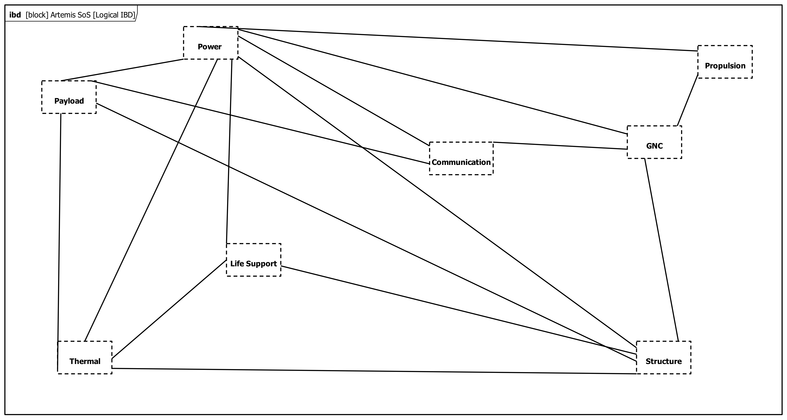
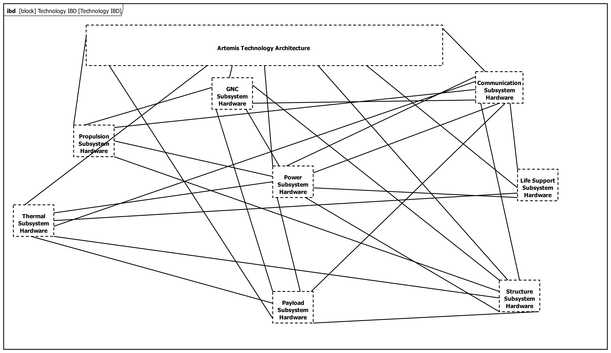
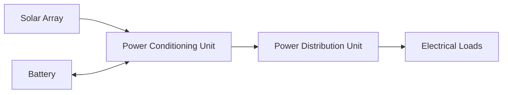
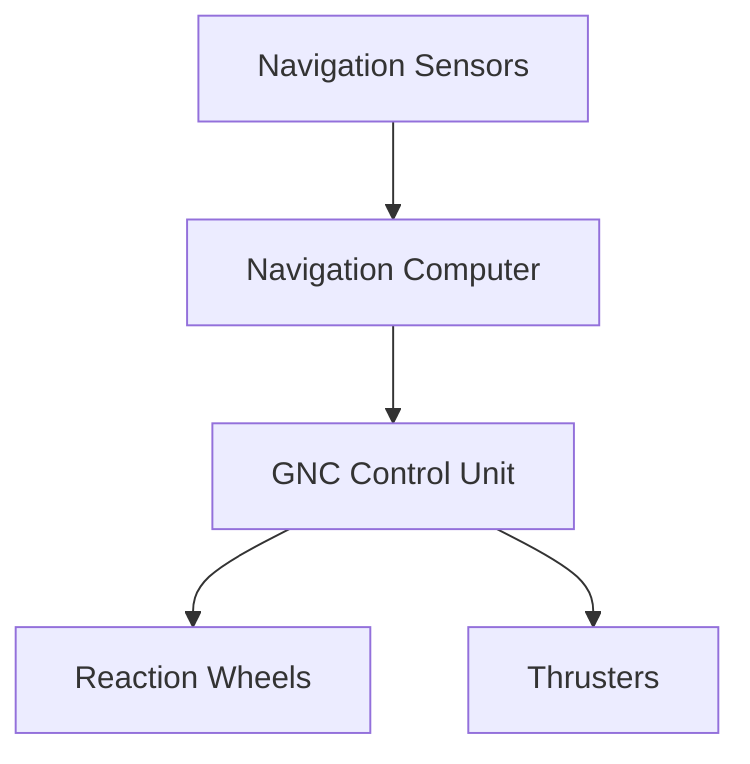
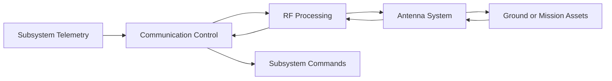
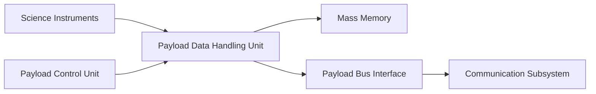

# Artemis Subsystem Interface Documentation

## 1. Introduction

This document describes subsystem relationships
within the academic Artemis System of Systems
architecture developed using Gaphor and SysML.

The interface analysis is based on the recovered
logical Internal Block Diagram, technology Internal
Block Diagram, individual subsystem diagrams,
and requirements diagrams.

The original models identify subsystem connections
but do not completely define interface directions,
exchanged items, electrical characteristics,
communication protocols, or acceptance limits.

This document provides a supplementary interface
register and identifies requirements for future
interface definition.

It is not an approved NASA Interface Control
Document (ICD).

## 2. Interface Engineering Objectives

- Identify subsystem dependencies.
- Document modeled subsystem connections.
- Identify potential exchanged information,
  energy, thermal resources, and mechanical loads.
- Establish proposed interface identifiers.
- Distinguish existing model relationships from
  proposed engineering interpretations.
- Identify missing interface specifications.
- Establish a foundation for future integration
  and interface verification.

## 3. Interface Categories

| Interface Category | Description |
|---|---|
| Electrical | Power generation, conditioning, distribution, and consumption |
| Data | Telemetry, scientific data, and subsystem status information |
| Command and Control | Operational commands and actuator instructions |
| Mechanical | Structural support, mounting, docking, and load transfer |
| Thermal | Heat transfer, temperature monitoring, and thermal regulation |
| Fluid | Propellant transport, environmental fluid handling, and heat transport |

The categories are supplementary classifications
introduced for engineering documentation.

The original diagrams do not explicitly assign
every connector to these interface categories.

## 4. Logical Subsystem Relationships

The logical architecture identifies eight
functional subsystems:

- Power
- Propulsion
- Thermal
- Life Support
- Guidance, Navigation, and Control (GNC)
- Communication
- Structure
- Payload

The logical IBD represents connections between
these subsystems.

The connectors provide a foundation for identifying
integration dependencies.

[Original Logical IBD](../diagrams/logical_level/Logical_IBD.pdf)

## 5. Logical Interface Register

The following register documents 15 subsystem
connections visible in the original logical IBD.

The interface IDs and potential exchanged items
are supplementary engineering interpretations.

They are not original model identifiers.

| Interface ID | Subsystem A | Subsystem B | Potential Interface Category | Potential Exchanged Item |
|---|---|---|---|---|
| IF-01 | Power | Propulsion | Electrical | Electrical power |
| IF-02 | Power | GNC | Electrical | Electrical power |
| IF-03 | Power | Communication | Electrical | Electrical power |
| IF-04 | Power | Life Support | Electrical | Electrical power |
| IF-05 | Power | Thermal | Electrical | Electrical power |
| IF-06 | Power | Payload | Electrical | Electrical power |
| IF-07 | Power | Structure | Mechanical | Equipment mounting |
| IF-08 | GNC | Propulsion | Command and Control | Maneuver commands |
| IF-09 | GNC | Communication | Data | Navigation and control information |
| IF-10 | GNC | Structure | Mechanical | Sensor and actuator mounting |
| IF-11 | Payload | Communication | Data | Scientific data and commands |
| IF-12 | Payload | Thermal | Thermal | Instrument heat and thermal support |
| IF-13 | Payload | Structure | Mechanical | Instrument mounting and load transfer |
| IF-14 | Life Support | Thermal | Thermal | Environmental temperature support |
| IF-15 | Life Support | Structure | Mechanical | Equipment mounting and support |
| IF-16 | Thermal | Structure | Thermal and Mechanical | Heat transfer and mounting support |

The register contains 16 listed interface entries.

The original connectors are not directional.

Proposed signal and energy directions require
separate interface definition and review.

## 6. Technology-Level Interfaces

The Technology IBD represents interconnections
between eight hardware-oriented subsystem blocks.

The hardware architecture provides a foundation
for identifying electrical, data, control,
mechanical, and thermal integration dependencies.

The available diagrams do not establish detailed
physical interface compatibility.

[Original Technology IBD](../diagrams/technology_level/Technology_IBD.pdf)

## 7. Power Subsystem Interfaces

The Power IBD identifies five internal components.

### Internal Connections

| Connected Components | Potential Interface Purpose |
|---|---|
| Solar Array and Power Conditioning Unit | Electrical energy input |
| Battery and Power Conditioning Unit | Energy storage and supply |
| Power Conditioning Unit and Power Distribution Unit | Conditioned electrical power |
| Power Distribution Unit and Cabling | Electrical power distribution |

### Supplementary Functional View

The arrows describe an illustrative functional
interpretation of the power architecture.

Battery charging direction and load distribution
details are not explicitly defined by the original IBD.

### Interface Parameters Requiring Definition

- DC bus voltage
- Voltage tolerance
- Maximum continuous current
- Peak current
- Battery capacity
- Charging characteristics
- Conversion efficiency
- Electrical protection requirements
- Connector and cabling specifications
- Grounding and isolation architecture

[Original Power IBD](../diagrams/technology_level/POWER_IBD.pdf)

[Power Subsystem Requirements](../diagrams/requirements/subsystem_level/Power_Subsystem.pdf)

[Power Hardware Requirements](../diagrams/requirements/hardware_level/Power_Subsystem_Hardware.pdf)

## 8. Propulsion Subsystem Interfaces

The Propulsion IBD represents five internal components.

### Internal Connections

| Connected Components | Potential Interface Category |
|---|---|
| Fuel Tank and Feed Lines | Fluid |
| Oxidiser Tank and Feed Lines | Fluid |
| Feed Lines and Main Engine | Fluid |
| Engine Controller and Main Engine | Command and Control |

The original model establishes component
relationships rather than detailed propulsion
interface specifications.

### Interface Parameters Requiring Definition

- Propellant characteristics
- Fluid pressure and flow limits
- Valve and feed-system architecture
- Engine command format
- Thrust control limits
- Propulsion status telemetry
- Thermal operating limits
- Electrical power requirements

The original hardware requirements contain
unresolved parameters D, E, and F relating
to total impulse, thrust range, and
commandable thrust resolution.

These parameters remain TBD.

[Original Propulsion IBD](../diagrams/technology_level/PROPULSION_IBD.pdf)

[Propulsion Subsystem Requirements](../diagrams/requirements/subsystem_level/Propulsion_Subsystem.pdf)

[Propulsion Hardware Requirements](../diagrams/requirements/hardware_level/Propulsion_Subsystem_Hardware.pdf)

## 9. GNC Subsystem Interfaces

The GNC architecture represents navigation
sensors, navigation processing, control
processing, and attitude-control actuators.

### Internal Connections

| Connected Components | Potential Exchanged Information |
|---|---|
| IMU and Navigation Computer | Inertial measurements |
| Star Tracker and Navigation Computer | Optical attitude observations |
| Gyroscopes and Navigation Computer | Angular-rate measurements |
| Accelerometer and Navigation Computer | Acceleration measurements |
| GPS Receiver and Navigation Computer | Navigation observations where available |
| Navigation Computer and GNC Control Unit | Estimated navigation state |
| GNC Control Unit and Reaction Wheels | Attitude-control commands |
| GNC Control Unit and Thrusters | Actuation commands |

### Supplementary Information Flow

The proposed information flow describes
an engineering interpretation of the original
component connections.

### Interface Parameters Requiring Definition

- Sensor data formats
- Sampling rates
- Navigation accuracy
- Coordinate reference frames
- Time synchronization
- Communication protocols
- Control command limits
- Actuator response characteristics
- Fault detection and redundancy

The original diagram includes both an IMU
and separate gyroscopes and accelerometers.

Their functional overlap and redundancy roles
require clarification.

GPS availability throughout lunar mission
phases is not established by this model.

[Original GNC IBD](../diagrams/technology_level/GNC_IBD.pdf)

[GNC Subsystem Requirements](../diagrams/requirements/subsystem_level/GNC_Subsystem.pdf)

[GNC Hardware Requirements](../diagrams/requirements/hardware_level/GNC_Subsystem_Hardware.pdf)

## 10. Communication Subsystem Interfaces

The Communication IBD represents six
hardware-oriented components.

### Internal Connections

| Connected Components | Potential Interface Interpretation |
|---|---|
| High-Gain Antenna and Antenna Pointing Mechanism | Mechanical pointing support |
| Antenna Pointing Mechanism and RF Transceiver/Modem | Interface requiring clarification |
| Low-Gain Antenna and RF Transceiver/Modem | Radio-frequency communication |
| RF Power Amplifier and RF Transceiver/Modem | RF signal processing and amplification |
| Communication Control Unit and RF Transceiver/Modem | Communication control and data |

The original diagram does not distinguish
every RF signal path from mechanical,
electrical, and control interfaces.

In particular, the connection through the
antenna pointing mechanism should not be
interpreted as a verified RF transmission path.

### Proposed Functional Information Flow

This is a supplementary information-flow
illustration and not an original RF schematic.

### Interface Parameters Requiring Definition

- Frequency bands
- Transmitter power
- Receiver sensitivity
- Antenna gain
- Data rates
- Modulation and coding
- Communication protocols
- Command authentication requirements
- Link availability and coverage
- Antenna pointing requirements
- Link budgets and performance margins

[Original Communication IBD](../diagrams/technology_level/COMMUNICATION_IBD.pdf)

[Communication Subsystem Requirements](../diagrams/requirements/subsystem_level/Communications_Subsystem.pdf)

[Communication Hardware Requirements](../diagrams/requirements/hardware_level/Communication_Hardware.pdf)

## 11. Thermal Subsystem Interfaces

The Thermal IBD represents temperature monitoring
and heat transport components.

### Internal Connections

| Connected Components | Potential Interface Category |
|---|---|
| Thermal Sensors and Thermal Control Unit | Measurement and control data |
| Heat Exchangers and Fluid Loops | Thermal and fluid |
| Fluid Loops and Radiators | Thermal and fluid |

The original diagram contains two separate
component groups.

The thermal monitoring and control group is
not explicitly connected to the heat transport
group.

### Interface Parameters Requiring Definition

- Equipment temperature limits
- Cabin temperature limits
- Sensor accuracy
- Heat generation rates
- Heat rejection capacity
- Coolant characteristics
- Fluid flow rates
- Heater power
- Thermal contact properties
- Control and monitoring interfaces

Insulation and heaters are identified in the
hardware requirements but are not shown as
separate components in the original Thermal IBD.

Their hardware allocation requires additional
definition.

[Original Thermal IBD](../diagrams/technology_level/THERMAL_IBD.pdf)

[Thermal Subsystem Requirements](../diagrams/requirements/subsystem_level/Thermal_Subsystem.pdf)

[Thermal Hardware Requirements](../diagrams/requirements/hardware_level/Thermal_Subsystem_Hardware.pdf)

## 12. Life Support Subsystem Interfaces

The Life Support IBD represents selected
environmental support components.

### Internal Connections

| Connected Components | Potential Interface Purpose |
|---|---|
| Oxygen Support and Air Circulation Fans | Atmosphere circulation support |
| CO2 Scrubber and Air Circulation Fans | Carbon dioxide removal support |
| Water Recovery System and Life Support Control Unit | Water-system monitoring and control |

The original diagram contains separate
atmosphere circulation and water recovery
component groups.

Detailed interactions between these groups
are not explicitly established.

### Interface Parameters Requiring Definition

- Oxygen concentration limits
- Carbon dioxide concentration limits
- Cabin pressure limits
- Humidity limits
- Air circulation rates
- Water recovery capacity
- Environmental sensor interfaces
- Emergency operation duration
- Power availability
- Fault monitoring and control

The requirements identify environmental
monitoring and emergency operation functions.

A complete hardware architecture would need
to allocate these functions to appropriate
monitoring, control, and backup equipment.

[Original Life Support IBD](../diagrams/technology_level/LIFE_SUPPORT_IBD.pdf)

[Life Support Subsystem Requirements](../diagrams/requirements/subsystem_level/Life_Support_Subsystem.pdf)

[Life Support Hardware Requirements](../diagrams/requirements/hardware_level/Life_Support_Hardware.pdf)

## 13. Structure Subsystem Interfaces

The Structure subsystem is represented through
logical decomposition and detailed component views.

### Logical Internal Connections

| Connected Components | Potential Interface Purpose |
|---|---|
| Load Bearing System and Mounting System | Structural support |
| Mounting System and Docking System Support | Mechanical integration |
| Mounting System and Thermal Interface System | Equipment and thermal integration |
| Docking System Support and Thermal Interface System | Mechanical and thermal coordination |

### Detailed Structural Connections

| Connected Components | Potential Interface Purpose |
|---|---|
| Primary Structure and Secondary Structure | Structural support |
| Primary Structure and Load-Bearing Frames | Load transfer |
| Primary Structure and Spacecraft Bus Frame | Structural integration |
| Secondary Structure and Fasteners and Brackets | Mechanical attachment |
| Load-Bearing Frames and Panels | Structural support |
| Fasteners and Brackets and Docking Interface | Mechanical attachment |
| Panels and Thermal/Structural Interface Points | Mechanical and thermal integration |
| Thermal/Structural Interface Points and Docking Interface | Interface coordination |
| Thermal/Structural Interface Points and Landing Struts | Interface coordination |

### Interface Parameters Requiring Definition

- Mechanical load cases
- Mounting dimensions
- Material properties
- Joint characteristics
- Fastener specifications
- Docking geometry
- Vibration limits
- Thermal expansion
- Structural safety factors
- Structural monitoring interfaces

The structural health monitoring requirement
identifies stress, vibration, and structural
condition data.

Dedicated structural monitoring components
are not explicitly represented in the
available detailed Structure IBD.

[Original Structure BDD](../diagrams/logical_level/Structure_BDD.pdf)

[Original Logical Structure IBD](../diagrams/logical_level/Structure_IBD.pdf)

[Detailed Structure IBD](../diagrams/technology_level/STRUCTURE_IBD.pdf)

[Structure Subsystem Requirements](../diagrams/requirements/subsystem_level/Structure_Subsystem.pdf)

[Structure Hardware Requirements](../diagrams/requirements/hardware_level/Structure_Subsystem_Hardware.pdf)

## 14. Payload Subsystem Interfaces

The Payload IBD represents scientific
instruments, data handling, storage,
control, and bus interfaces.

### Internal Connections

| Connected Components | Potential Exchanged Information |
|---|---|
| Science Camera and Payload Data Handling Unit | Image data |
| Spectrometer and Payload Data Handling Unit | Spectral measurements |
| LIDAR/RADAR and Payload Data Handling Unit | Instrument observations |
| Payload Data Handling Unit and Payload Mass Memory | Stored scientific data |
| Payload Data Handling Unit and Payload Control Unit | Instrument commands and status |
| Payload Data Handling Unit and Payload Bus Interface | Data and control exchange |

### Supplementary Functional View

The connection to the Communication subsystem
is a supplementary interpretation supported
by the payload data transfer requirements
and logical architecture.

### Interface Parameters Requiring Definition

- Instrument data formats
- Sampling rates
- Data throughput
- Storage capacity
- Bus protocol
- Command formats
- Instrument power demand
- Thermal operating limits
- Data integrity requirements

[Original Payload IBD](../diagrams/technology_level/PAYLOAD_IBD.pdf)

[Payload Subsystem Requirements](../diagrams/requirements/subsystem_level/Payload_Subsystem.pdf)

[Payload Hardware Requirements](../diagrams/requirements/hardware_level/Payload_Hardware.pdf)

## 15. Requirement-Driven Interface Candidates

Several subsystem requirements describe
information exchanges that require further
interface modeling.

The following entries are candidate interfaces
derived from the requirement statements.

They are not asserted to be existing direct
connectors in the original logical IBD.

| Candidate ID | Source | Destination | Proposed Exchanged Item | Original Requirement |
|---|---|---|---|---|
| CAND-01 | Power | Communication | Voltage, current, and state-of-charge telemetry | Power Req-04 |
| CAND-02 | Propulsion | Communication | Propellant level telemetry | Propulsion Req-08 |
| CAND-03 | Life Support | Communication | Environmental sensor telemetry | Life Support Req-16 |
| CAND-04 | Thermal | Communication | Temperature telemetry | Thermal Req-12 |
| CAND-05 | Structure | Communication | Structural condition telemetry | Structure Req-28 |
| CAND-06 | Payload | Communication | Scientific data | Payload Req-30 and Payload Hardware Req-14 |
| CAND-07 | Communication | Payload | Operational mode commands | Payload Req-32 |
| CAND-08 | GNC | Propulsion | Maneuver guidance and control commands | GNC Req-18 and Propulsion Req-06 |
| CAND-09 | Communication | Ground Support | Subsystem telemetry | Communication Req-23 |
| CAND-10 | Ground Support | Communication | Commands | Communication Req-24 |

The Communication subsystem is a proposed
destination for thermal and structural telemetry.

The original requirements do not explicitly
specify that destination in every case.

A detailed interface review must distinguish
direct connections, routed information,
and external mission interfaces.

## 16. Interface Control Register Template

A future Interface Control Document should
define the following fields for each interface.

| Field | Definition |
|---|---|
| Interface ID | Unique interface identifier |
| Source | Originating system or component |
| Destination | Receiving system or component |
| Interface Type | Electrical, data, control, mechanical, thermal, or fluid |
| Exchanged Item | Signal, energy, resource, or load |
| Direction | Unidirectional or bidirectional |
| Units | Applicable engineering units |
| Nominal Value | Defined operating value |
| Operating Range | Permitted minimum and maximum |
| Protocol | Communication or control protocol |
| Timing | Update rate, latency, or response time |
| Physical Connection | Connector, mounting, or physical medium |
| Fault Behavior | Expected response to interface failure |
| Requirement Reference | Associated requirement identifier |
| Verification Method | Inspection, analysis, demonstration, or test |
| Verification Status | Current evidence and completion state |

Unknown parameters should be recorded as TBD
rather than assigned unsupported numerical values.

## 17. Example Preliminary Interface Records

These records illustrate the proposed
documentation methodology.

| Parameter | IF-02: Power-GNC | IF-08: GNC-Propulsion | IF-11: Payload-Communication |
|---|---|---|---|
| Category | Electrical | Command and Control | Data |
| Potential exchanged item | DC electrical power | Maneuver commands | Scientific data |
| Proposed direction | Power to GNC | GNC to Propulsion | Payload to Communication |
| Voltage or signal level | TBD | TBD | TBD |
| Current requirement | TBD | TBD | TBD |
| Protocol | Not applicable or TBD | TBD | TBD |
| Timing requirement | TBD | TBD | TBD |
| Verification method | Electrical analysis and test | Interface and integration test | Data transfer test |
| Verification status | Not performed | Not performed | Not performed |

These are proposed engineering records.

They are not measured values or approved
interface specifications.

## 18. Integration Dependencies

The subsystem architecture identifies several
important engineering dependencies.

### Power Dependency

Electrical equipment requires appropriate
power availability and distribution.

A power disturbance could affect navigation,
communication, payload operation, thermal
control, and life support.

### Communication Dependency

Telemetry and operational commands require
defined communication paths.

A communication disruption could reduce
system monitoring and command availability.

### Navigation and Propulsion Dependency

Navigation estimates and guidance commands
support maneuver execution.

Incorrect or unavailable information could
affect intended maneuver performance.

### Thermal Dependency

Temperature-sensitive equipment requires
appropriate thermal management.

Inadequate heat rejection or temperature
control could affect subsystem operation.

### Structural Dependency

Subsystems require mechanical support,
mounting, and integration.

Structural disturbances could affect
equipment alignment and operation.

These are qualitative engineering dependency
observations.

They do not constitute a completed failure
analysis or quantitative reliability assessment.

## 19. Proposed Interface Verification Methods

| Interface Category | Proposed Verification Method |
|---|---|
| Electrical | Power budget analysis, voltage and current measurement, load testing |
| Data | Message integrity checks, throughput measurements, communication testing |
| Command and Control | Functional testing, timing analysis, integration testing |
| Mechanical | Interface inspection, structural analysis, vibration testing |
| Thermal | Thermal analysis, temperature measurement, heat-transfer testing |
| Fluid | Compatibility analysis, leak testing, flow and pressure testing |

The proposed methods would require defined
acceptance criteria, appropriate equipment,
and controlled engineering test conditions.

No physical interface verification has
been performed as part of this documentation.

## 20. Interface Modeling Improvement Opportunities

| ID | Observed Gap | Recommended Action |
|---|---|---|
| GAP-01 | Original connectors lack explicit directions | Add item flows and interface directions |
| GAP-02 | Electrical parameters are undefined | Define voltage, current, and power constraints |
| GAP-03 | Communication protocols are undefined | Define data formats and interface protocols |
| GAP-04 | Thermal component groups are disconnected | Define monitoring and actuator relationships |
| GAP-05 | Life Support component groups are disconnected | Define environmental control interfaces |
| GAP-06 | RF and pointing connections are not distinguished | Separate RF, mechanical, and control interfaces |
| GAP-07 | GNC sensor roles potentially overlap | Clarify sensor composition and allocation |
| GAP-08 | Telemetry requirements lack complete interface paths | Allocate and document telemetry routing |
| GAP-09 | Structural monitoring equipment is not explicitly modeled | Define structural health monitoring components |
| GAP-10 | Vehicle-specific interfaces are not established | Allocate hardware and interfaces to mission elements |
| GAP-11 | Interface acceptance limits are missing | Develop measurable verification criteria |

These observations apply to the available
diagram exports.

The editable model may contain information
that is not visible in the exported views.

## 21. Interface Engineering Limitations

- The editable Gaphor source model is unavailable.
- Complete interface port definitions are not established.
- Many connector directions remain unspecified.
- Electrical and communication specifications are incomplete.
- Proposed exchanged items require formal review.
- Hardware compatibility has not been demonstrated.
- Vehicle-specific subsystem allocations are incomplete.
- Quantitative interface performance is unverified.
- Physical integration testing has not been performed.
- The document is not an approved Interface Control Document.

The original SysML exports have been preserved
without modification.

## 22. Supporting Documentation

- [Mission Overview](mission_overview.md)
- [System Architecture](system_architecture.md)
- [Logical Internal Block Diagram](../diagrams/logical_level/Logical_IBD.pdf)
- [Technology Internal Block Diagram](../diagrams/technology_level/Technology_IBD.pdf)
- [Mission Requirements](../diagrams/requirements/mission_level/Requirements.pdf)
- [Original Project Report](../ARTEMIS%20MISSION%20AND%20SPACECRAFT%20ARCHITECTING%20USING%20GAPHOR.pdf)

## 23. Conclusion

The Artemis subsystem interface documentation
organizes the original modeled connections
and identifies potential engineering exchanges
between functional and hardware components.

The supplementary interface register,
requirement-driven interface candidates,
and preliminary interface control records
provide a foundation for future integration
engineering and verification.

The documentation distinguishes original
model relationships from proposed interface
specifications and preserves the limitations
of the available academic architecture.
