# Artemis System Architecture

## 1. Architecture Overview

This document describes the System of Systems architecture
developed for the academic Artemis mission modeling project
using Gaphor and SysML.

The architecture is organized into three levels:

- Concept level
- Logical level
- Technology level

These levels represent progressively more detailed
engineering viewpoints, beginning with mission elements,
continuing through functional subsystems, and extending
to hardware-oriented subsystem architecture.

The documentation is based on the original exported
SysML diagrams.

It is an academic reference architecture and does not
represent an official NASA engineering baseline.

## 2. Architecture Objectives

- Establish the system boundary.
- Identify major mission elements.
- Represent functional subsystem decomposition.
- Identify subsystem dependencies.
- Represent hardware-oriented architecture.
- Document internal subsystem structures.
- Establish a foundation for requirements allocation.
- Identify architecture and interface modeling gaps.

## 3. Architecture Modeling Framework

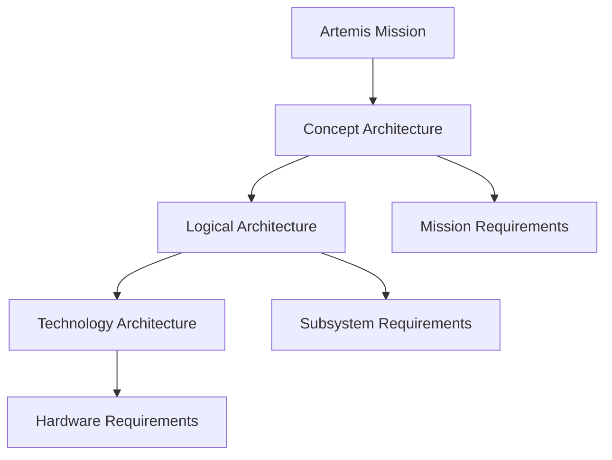

This supplementary diagram summarizes the organization
of the recovered SysML artifacts.

The arrows represent the intended progression between
architectural viewpoints, not formally verified
allocation relationships in the editable model.

## 4. Concept-Level Architecture

The concept-level architecture represents Artemis
as a System of Systems.

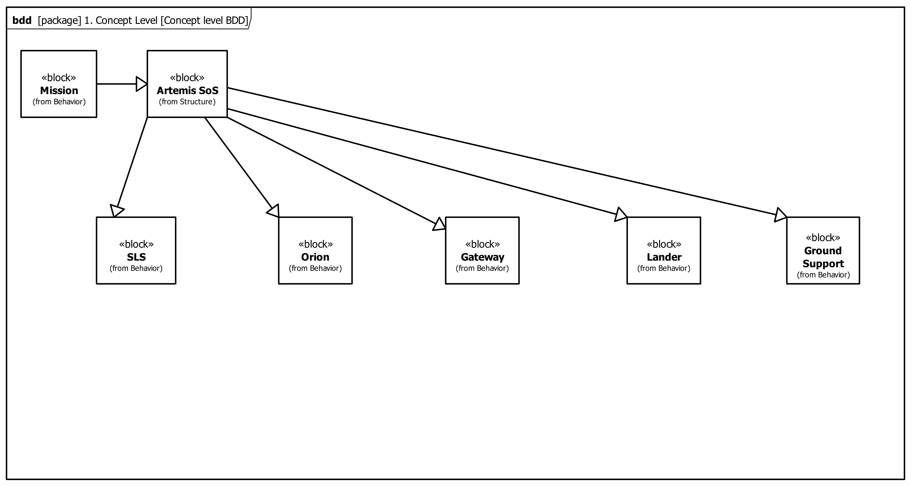

The original model identifies the following elements:

| Element | Intended Responsibility |
|---|---|
| Artemis SoS | Overall system boundary |
| SLS | Launch and mission transportation |
| Orion | Crewed spacecraft transportation |
| Gateway | Lunar orbital support |
| Lander | Lunar surface access and return |
| Ground Support | Command, tracking, telemetry, and mission coordination |

The responsibility descriptions are explanatory
interpretations of the modeled mission elements.

The concept model establishes the scope of the study
rather than a complete mission-specific physical design.

[Original Concept-Level BDD](../diagrams/concept_level/Concept_level_BDD.pdf)

## 5. Logical-Level Architecture

The logical architecture decomposes the system into
eight major functional subsystems.

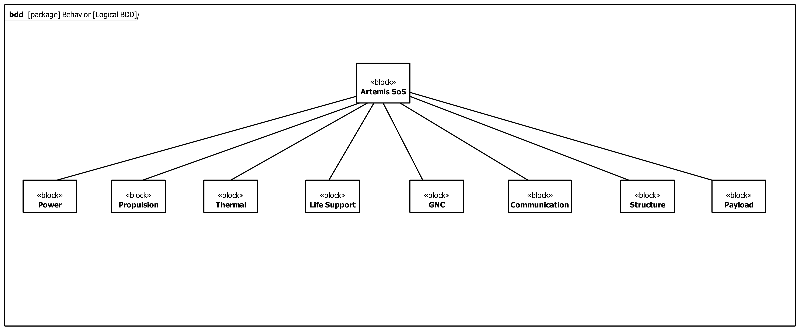

| Subsystem | Functional Responsibility |
|---|---|
| Power | Electrical power availability and distribution |
| Propulsion | Maneuvering and thrust generation |
| Thermal | Temperature control and heat rejection |
| Life Support | Crew environmental support |
| GNC | Guidance, navigation, and control |
| Communication | Command and telemetry exchange |
| Structure | Mechanical support and structural integrity |
| Payload | Scientific measurements and data handling |

These functional areas are represented at the
System of Systems level.

Their allocation to individual spacecraft or
mission elements requires further definition.

[Original Logical BDD](../diagrams/logical_level/Logical_BDD.pdf)

## 6. Logical Internal Architecture

The logical Internal Block Diagram represents
relationships among the eight functional subsystems.

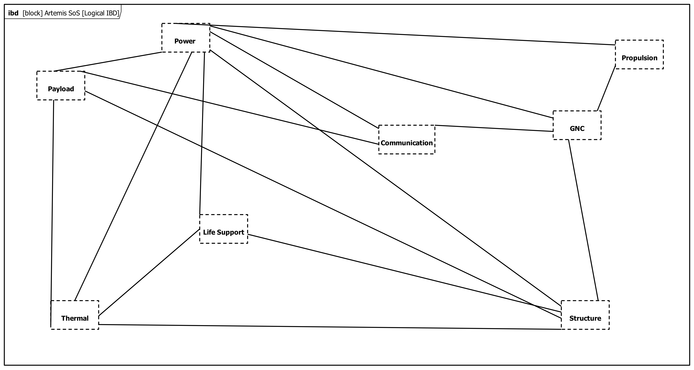

The diagram identifies subsystem connections
without explicitly defining every exchanged item,
interface direction, protocol, or quantitative limit.

Selected relationships visible in the original diagram
include:

| Connected Subsystems | Potential Interface Purpose |
|---|---|
| Power and Propulsion | Electrical power support |
| Power and GNC | Electrical power for navigation and control |
| Power and Communication | Electrical power for communication equipment |
| Power and Life Support | Electrical power for environmental systems |
| Power and Thermal | Electrical power for thermal equipment |
| Power and Payload | Electrical power for scientific instruments |
| GNC and Propulsion | Maneuver guidance and control |
| GNC and Communication | Navigation and control information |
| Payload and Communication | Scientific data and commands |
| Payload and Thermal | Instrument thermal support |
| Life Support and Thermal | Environmental temperature support |
| Thermal and Structure | Thermal and mechanical integration |

The interface purposes are engineering interpretations.

The original connectors establish modeled relationships,
but do not independently establish interface specifications.

[Original Logical IBD](../diagrams/logical_level/Logical_IBD.pdf)

## 7. Technology-Level Architecture

The technology-level architecture represents
hardware-oriented subsystem decomposition.

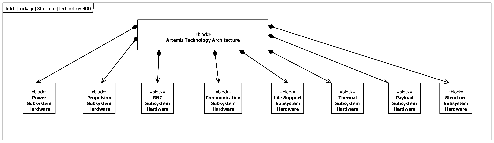

The original Technology BDD uses composition
relationships to organize eight hardware subsystem
blocks within the Artemis Technology Architecture.

| Hardware Subsystem | Corresponding Logical Area |
|---|---|
| Power Subsystem Hardware | Power |
| Propulsion Subsystem Hardware | Propulsion |
| GNC Subsystem Hardware | GNC |
| Communication Subsystem Hardware | Communication |
| Life Support Subsystem Hardware | Life Support |
| Thermal Subsystem Hardware | Thermal |
| Payload Subsystem Hardware | Payload |
| Structure Subsystem Hardware | Structure |

The correspondence is based on subsystem naming
and functional responsibility.

Formal model allocation relationships between
all logical and technology elements have not
been independently verified.

[Original Technology BDD](../diagrams/technology_level/Technology_BDD.pdf)

## 8. Technology Internal Architecture

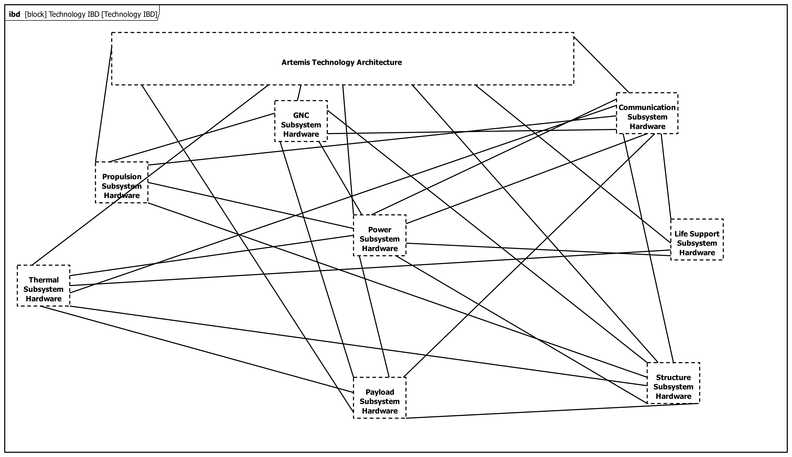

The Technology IBD represents connections among
hardware subsystem blocks.

The diagram provides a structural foundation
for identifying hardware integration dependencies.

Detailed electrical, mechanical, thermal,
fluid, and communication interface specifications
remain subject to further development.

[Original Technology IBD](../diagrams/technology_level/Technology_IBD.pdf)

## 9. Power Subsystem Architecture

The Power IBD represents the following components:

- Solar Array
- Battery
- Power Conditioning Unit
- Power Distribution Unit
- Cabling

The solar array and battery are connected to
the Power Conditioning Unit.

The conditioning unit connects to the
Power Distribution Unit and distribution cabling.

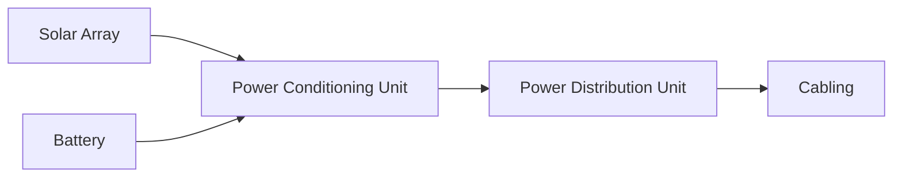

This explanatory diagram interprets the connections
in the original Power IBD.

The original model does not establish bus voltage,
battery capacity, current limits, protection
architecture, or power conversion efficiency.

[Original Power IBD](../diagrams/technology_level/POWER_IBD.pdf)

## 10. Propulsion Subsystem Architecture

The Propulsion IBD represents:

- Fuel Tank
- Oxidiser Tank
- Feed Lines
- Main Engine
- Engine Controller

The fuel and oxidiser tanks connect through
feed lines to the main engine.

The engine controller is connected to
the main engine.

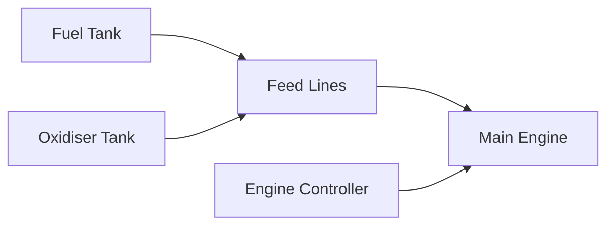

The original architecture identifies major
propulsion components but does not establish
a complete propulsion engineering design.

Propellant selection, thrust performance,
total impulse, valve architecture, and operating
limits remain undefined in this view.

[Original Propulsion IBD](../diagrams/technology_level/PROPULSION_IBD.pdf)

## 11. Guidance, Navigation, and Control Architecture

The GNC IBD represents sensor inputs,
navigation processing, control processing,
and attitude-control actuators.

The original components include:

- Inertial Measurement Unit (IMU)
- Star Tracker
- Gyroscopes
- Accelerometer
- GPS Receiver
- Navigation Computer
- GNC Control Unit
- Reaction Wheels
- Thrusters

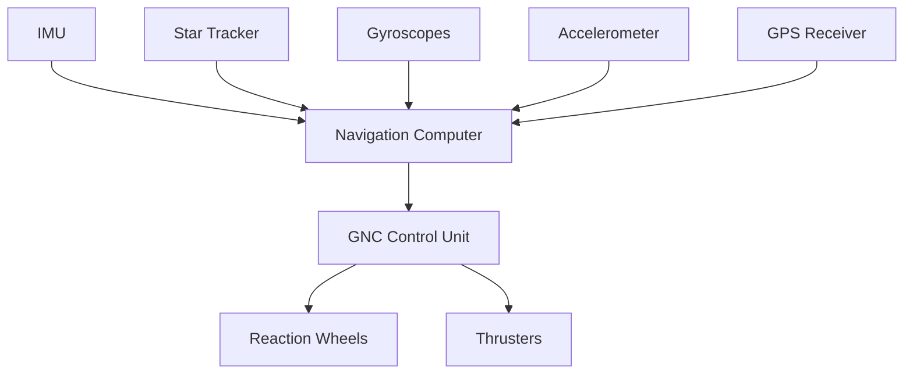

The diagram represents a conceptual sensing,
processing, and actuation architecture.

The presence of a GPS receiver does not establish
navigation availability throughout lunar mission phases.

Sensor accuracy, navigation algorithms, control laws,
actuator limits, redundancy, and mission-specific
navigation methods require additional definition.

[Original GNC IBD](../diagrams/technology_level/GNC_IBD.pdf)

## 12. Communication Subsystem Architecture

The Communication IBD represents:

- High-Gain Antenna
- Low-Gain Antenna
- Antenna Pointing Mechanism
- RF Transceiver/Modem
- RF Power Amplifier
- Communication Control Unit

The RF Transceiver/Modem is connected to the
low-gain antenna, RF power amplifier,
communication control unit, and antenna
pointing mechanism.

The high-gain antenna is connected to
the antenna pointing mechanism.

These connections are preserved as represented
in the original diagram.

They do not establish a complete RF signal path.

A detailed design would distinguish mechanical
pointing interfaces, RF transmission paths,
electrical power interfaces, and control signals.

Frequency bands, transmit power, antenna gain,
communication protocols, and link budgets
remain undefined in this model.

[Original Communication IBD](../diagrams/technology_level/COMMUNICATION_IBD.pdf)

## 13. Thermal Subsystem Architecture

The Thermal IBD represents:

- Thermal Sensors
- Thermal Control Unit
- Heat Exchangers
- Fluid Loops
- Radiators

The thermal sensors are connected to
the thermal control unit.

The heat exchangers are connected through
fluid loops to radiators.

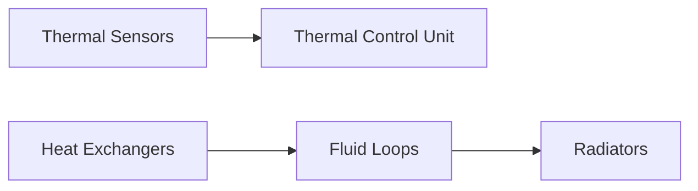

The original diagram represents temperature
monitoring and heat transport architecture.

The control connections between the thermal
control unit and heat-management equipment
are not explicitly established in this view.

The hardware requirements also identify
insulation and heaters, which are not shown
as separate components in this IBD.

Heat loads, radiator dimensions, fluid properties,
and operating temperature limits require
additional engineering definition.

[Original Thermal IBD](../diagrams/technology_level/THERMAL_IBD.pdf)

## 14. Life Support Subsystem Architecture

The Life Support IBD represents:

- Oxygen Support
- CO2 Scrubber
- Air Circulation Fans
- Water Recovery System
- Life Support Control Unit

The oxygen support and carbon dioxide scrubber
are connected to air circulation fans.

The water recovery system is connected to
the life support control unit.

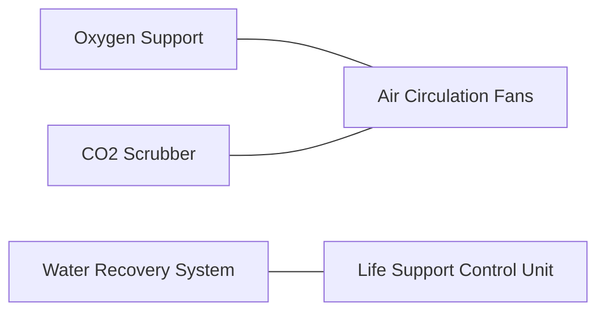

The model represents selected environmental
support functions.

The atmosphere circulation and water recovery
groups are not explicitly interconnected
in the original IBD.

A complete architecture would require
additional environmental monitoring,
control interfaces, storage, fault handling,
and emergency operation definitions.

Atmospheric limits, crew consumption rates,
water recovery capacity, and emergency
operating duration remain undefined.

[Original Life Support IBD](../diagrams/technology_level/LIFE_SUPPORT_IBD.pdf)

## 15. Structure Subsystem Architecture

The original project includes two logical-level
structure diagrams and one detailed component IBD.

### Logical Structure Decomposition

The Structure BDD identifies four elements:

- Load Bearing System
- Mounting System
- Thermal Interface System
- Docking System Support

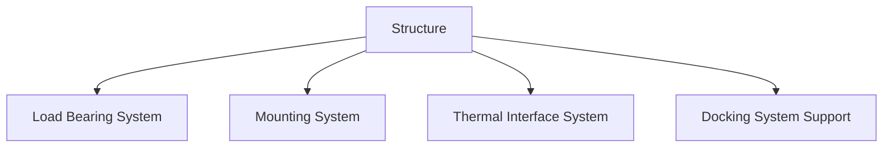

[Original Structure BDD](../diagrams/logical_level/Structure_BDD.pdf)

### Logical Structure Interfaces

The Structure IBD represents connections between
the load-bearing, mounting, docking support,
and thermal interface elements.

[Original Structure IBD](../diagrams/logical_level/Structure_IBD.pdf)

### Detailed Structural Components

The technology-oriented Structure IBD includes:

- Primary Structure
- Secondary Structure
- Load-Bearing Frames
- Spacecraft Bus Frame
- Fasteners and Brackets
- Panels
- Thermal/Structural Interface Points
- Docking Interface
- Landing Struts

The architecture represents structural support,
subsystem mounting, and selected mechanical
interface functions.

Materials, dimensions, load cases, stress limits,
vibration limits, and structural safety factors
are not established.

[Detailed Structure IBD](../diagrams/technology_level/STRUCTURE_IBD.pdf)

## 16. Payload Subsystem Architecture

The Payload IBD represents:

- Science Camera
- Spectrometer
- LIDAR/RADAR
- Payload Data Handling Unit
- Payload Mass Memory
- Payload Control Unit
- Payload Bus Interface

The scientific instruments connect to
the Payload Data Handling Unit.

The data handling unit also connects
to memory, control, and bus interfaces.

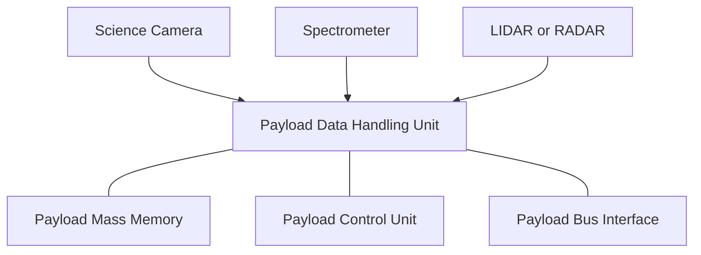

This supplementary view represents the
intended payload data-processing architecture.

Instrument resolution, sampling rates,
storage capacity, interface protocols,
and downlink data rates remain undefined.

[Original Payload IBD](../diagrams/technology_level/PAYLOAD_IBD.pdf)

## 17. Architecture Artifact Inventory

| Diagram Category | Count |
|---|---:|
| Block Definition Diagrams | 4 |
| Internal Block Diagrams | 11 |
| Requirements Diagrams | 18 |
| Total Original SysML Exports | 33 |

The requirements diagrams include mission-level,
subsystem-level, and hardware-level requirement views.

Seven supplementary PNG previews are available
for selected original PDF diagrams.

## 18. Architecture and Requirements Relationships

The architecture is supported by a documented
inventory of 60 requirements.

| Level | Requirements |
|---|---:|
| Mission | 12 |
| Logical subsystem | 32 |
| Technology hardware | 16 |
| Total | 60 |

The mission requirements relationship diagram
contains refine and satisfy dependencies
between requirements and subsystem blocks.

These relationships provide an initial
requirements traceability foundation.

They do not establish complete allocation coverage
or verified requirement satisfaction.

[Original Requirements Relationship Diagram](../diagrams/requirements/mission_level/Requirements%20with%20refine%20and%20satisfy%20links.pdf)

## 19. Architecture Modeling Observations

A review of the exported diagrams identifies
the following development opportunities.

| Observation | Recommended Improvement |
|---|---|
| Concept-level links use generalization notation | Review whether composition or association better represents the intended system relationships |
| Logical connectors lack detailed exchanged items | Define interface ports, directions, and item flows |
| Hardware allocation is not explicitly established across every level | Add logical-to-physical allocation relationships |
| GNC includes potentially overlapping inertial sensor blocks | Clarify IMU composition and independent sensor roles |
| RF and antenna pointing relationships are not differentiated | Separate RF, control, and mechanical interfaces |
| Thermal monitoring and heat transport groups are not explicitly connected | Define thermal control and actuator interfaces |
| Insulation and heaters appear in requirements but not as separate IBD components | Complete hardware representation and allocation |
| Life Support contains separate component groups | Define missing monitoring and control interactions |
| Requirement identifiers are reused across levels | Introduce qualified traceability identifiers |

These observations are based on visual inspection
of the exported diagrams.

They are not results from an automated Gaphor
model consistency checker.

The original models remain unchanged.

## 20. Engineering Limitations

The available architecture exports do not establish:

- A complete editable SysML model.
- Formal SysML semantic conformance.
- Complete interface specifications.
- Verified logical-to-hardware allocations.
- Vehicle-specific hardware configurations.
- Quantitative subsystem performance.
- Mass, power, thermal, or communication budgets.
- Executable mission behavior.
- Complete redundancy and fault-tolerance architecture.
- Verified requirements satisfaction.
- Flight qualification or mission readiness.

The architecture should be interpreted as
an academic systems engineering study.

## 21. Supporting Documentation

- [Mission Overview](mission_overview.md)
- [Original Project Report](../ARTEMIS%20MISSION%20AND%20SPACECRAFT%20ARCHITECTING%20USING%20GAPHOR.pdf)
- [Mission Requirements](../diagrams/requirements/mission_level/Requirements.pdf)
- [Concept Architecture](../diagrams/concept_level/Concept_level_BDD.pdf)
- [Logical Architecture](../diagrams/logical_level/Logical_BDD.pdf)
- [Technology Architecture](../diagrams/technology_level/Technology_BDD.pdf)

## 22. Conclusion

The Artemis architecture project demonstrates
a structured approach to representing a complex
System of Systems through SysML viewpoints.

The recovered diagrams establish mission-level,
logical-level, and technology-level representations
of the reference architecture.

The subsystem decomposition provides a foundation
for interface definition, requirements allocation,
architecture review, and future engineering verification.

The original diagrams and supplementary documentation
are distinguished to preserve model provenance
and engineering transparency.
