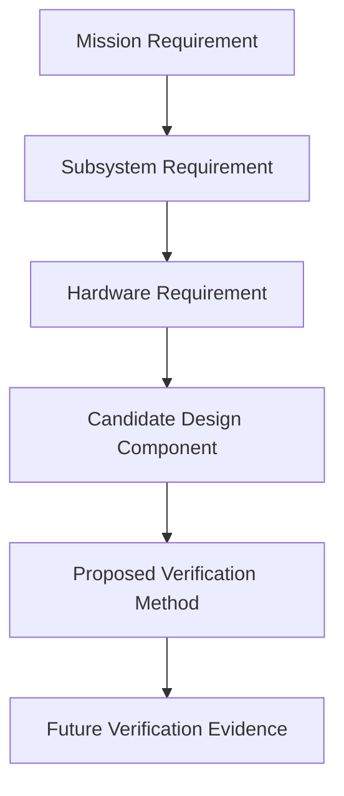
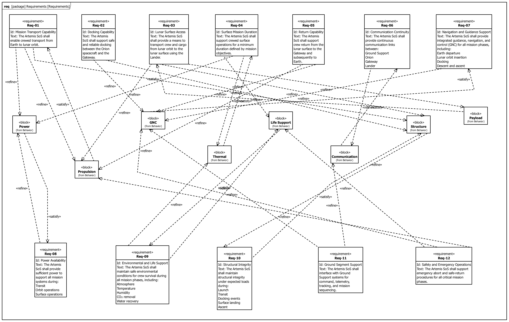
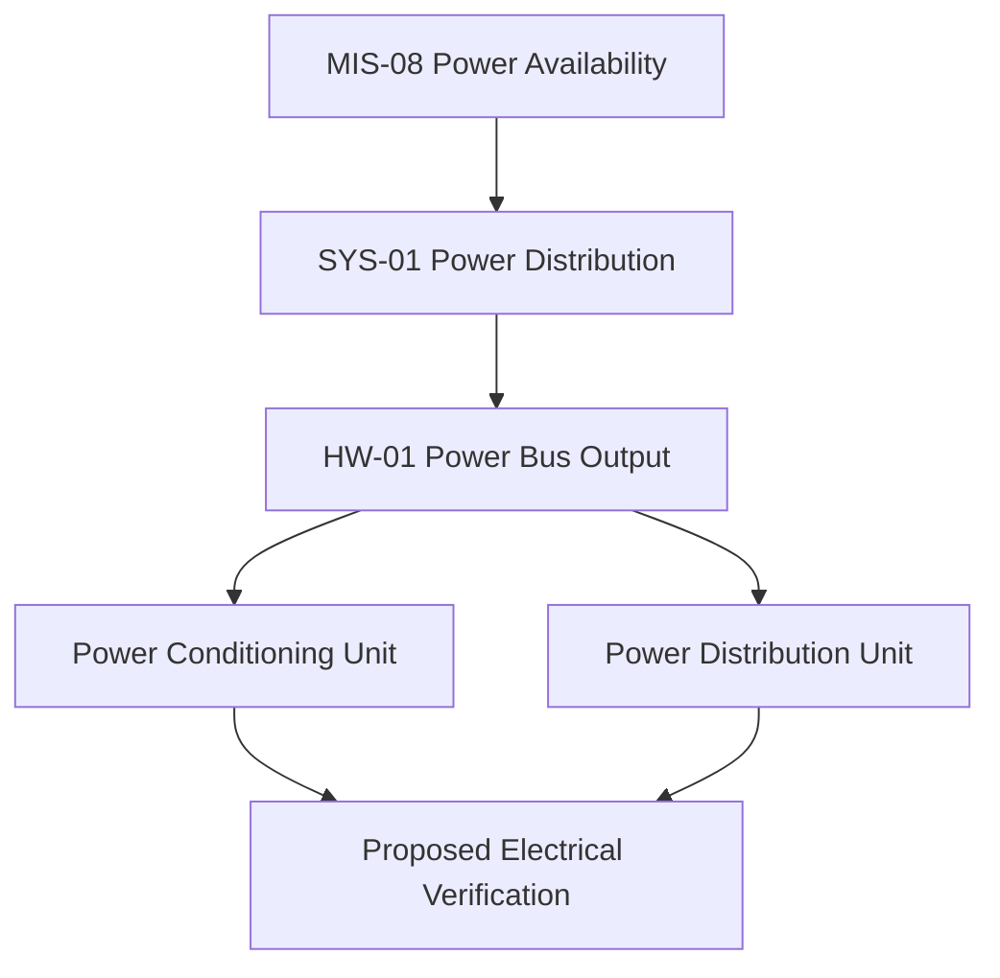
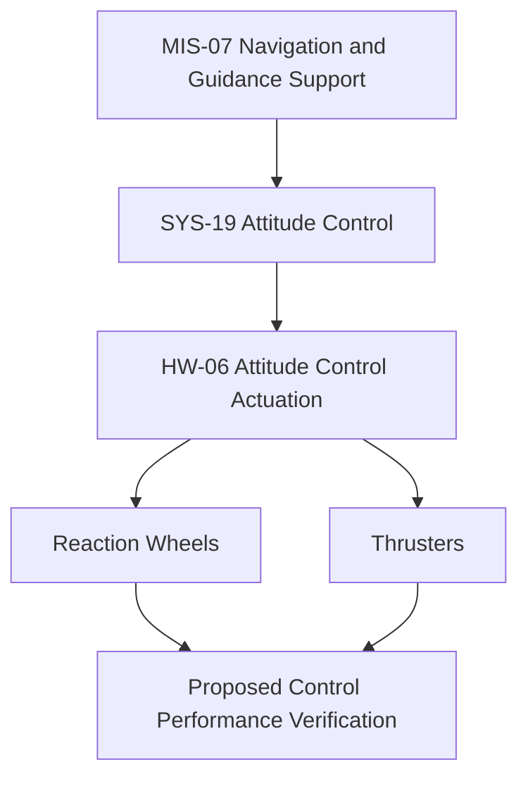
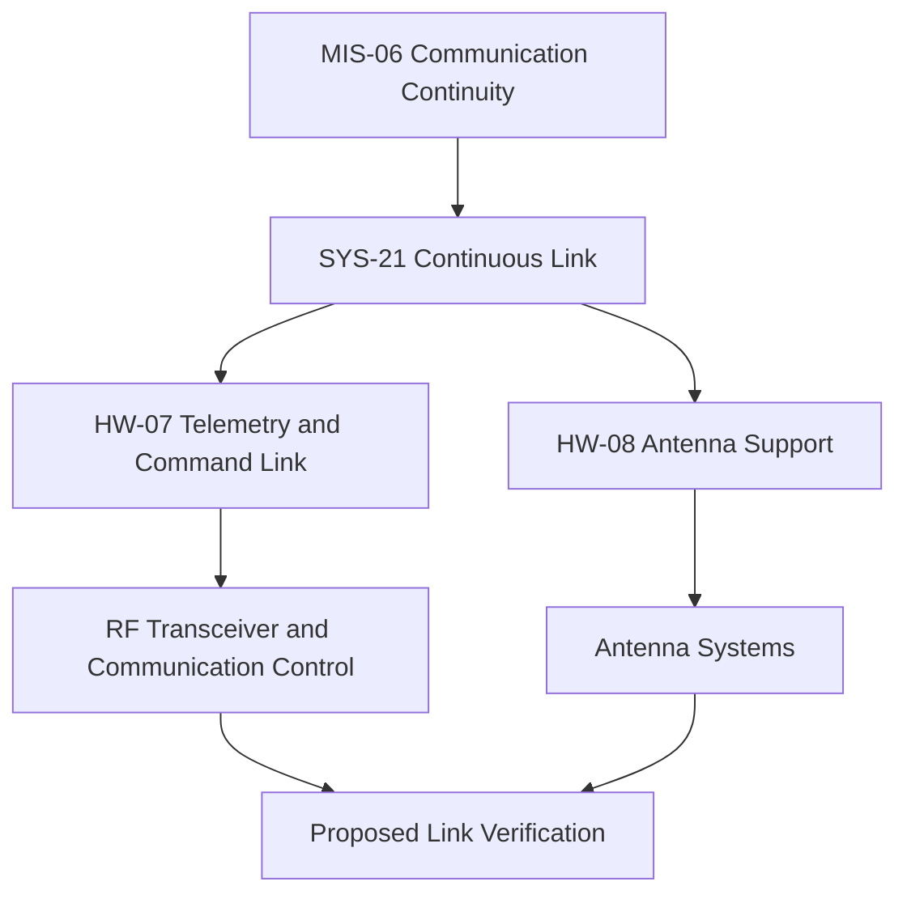
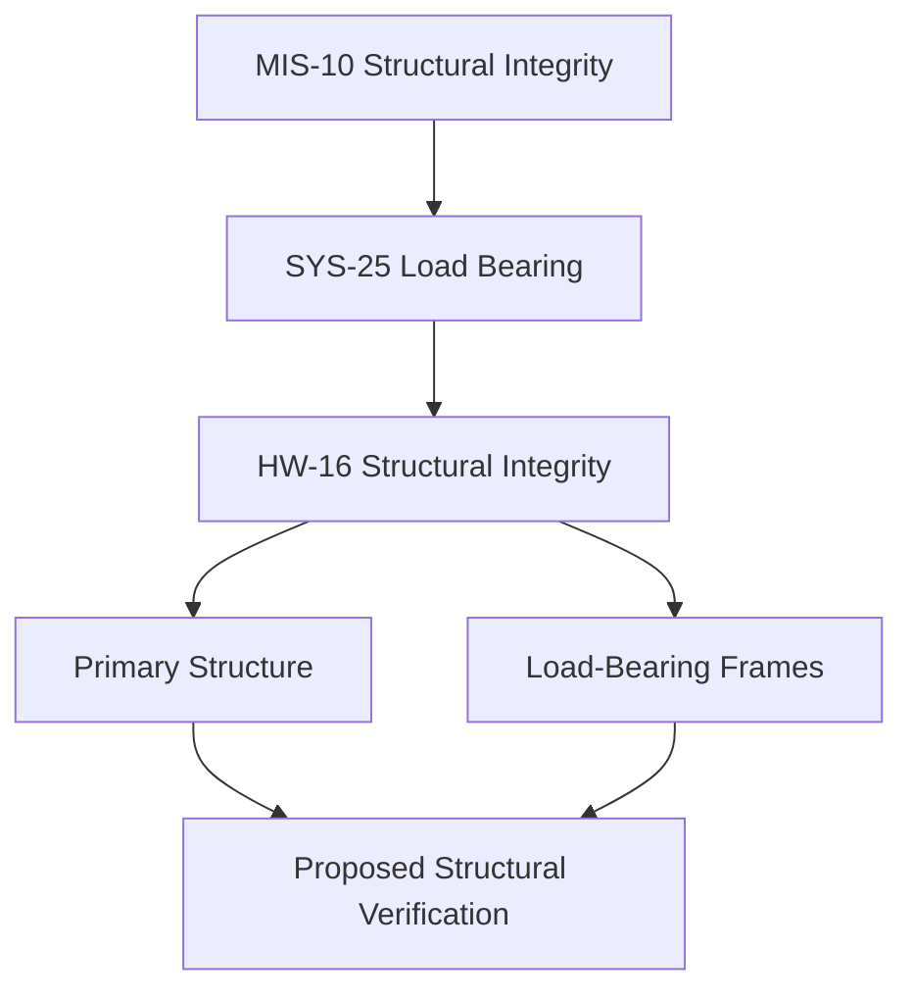

# Artemis Requirements Traceability Matrix

## 1. Introduction

This document establishes a supplementary Requirements
Traceability Matrix (RTM) for the academic Artemis
System of Systems architecture developed using
Gaphor and SysML.

The matrix connects documented mission requirements,
logical subsystem requirements, technology hardware
requirements, and candidate design components.

The original exported requirements diagrams contain
60 requirements across three architectural levels.

The proposed mappings in this document are derived
from requirement descriptions and architecture views.

They are not assertions that equivalent formal
relationships exist in the original editable model.

This document is an academic engineering artifact,
not an approved NASA requirements baseline.

## 2. Traceability Objectives

- Establish unambiguous requirement references.
- Identify candidate mission-to-subsystem relationships.
- Identify candidate subsystem-to-hardware relationships.
- Associate requirements with modeled design components.
- Identify incomplete requirement allocations.
- Propose requirement verification methods.
- Distinguish documentation coverage from compliance.
- Support future model development and verification.

## 3. Requirement Identification

| Architectural Level | Qualified ID Range | Count |
|---|---|---:|
| Mission | MIS-01 to MIS-12 | 12 |
| Logical subsystem | SYS-01 to SYS-32 | 32 |
| Technology hardware | HW-01 to HW-16 | 16 |
| Total | | 60 |

The qualified identifiers were introduced in the
supplementary requirements inventory.

The original requirement identifiers remain unchanged
in the exported SysML diagrams.

[Consolidated Requirements Inventory](requirements.md)

## 4. Traceability Methodology

The proposed traceability process follows the
engineering hierarchy from mission objectives
to functional and hardware requirements.

The relationships represented in this flowchart
describe the supplementary traceability methodology.

They do not represent verified formal SysML links.

### Relationship Status Definitions

| Status | Meaning |
|---|---|
| Original modeled relationship | Relationship visible in an original exported diagram |
| Proposed mapping | Supplementary engineering association derived from requirement content |
| Partial allocation | Candidate design elements address only part of a requirement |
| Open allocation | Additional design elements or requirements are needed |
| Not verified | No completed compliance evidence is established |

All mappings in the following tables are proposed
unless explicitly identified otherwise.

## 5. Original SysML Requirement Relationships

The original mission requirements diagram contains
refine and satisfy relationships between mission
requirements and subsystem blocks.

A refine relationship provides additional detail
or clarification of a requirement.

A satisfy relationship expresses intended
satisfaction of a requirement by a design element.

The original diagram does not independently establish
complete requirement-to-requirement traceability
across all three architectural levels.

The supplementary matrices below extend the
documentation using proposed engineering mappings.

[Original Refine and Satisfy Diagram](../diagrams/requirements/mission_level/Requirements%20with%20refine%20and%20satisfy%20links.pdf)

## 6. Mission-to-Subsystem Traceability

The following matrix provides candidate subsystem
requirement associations for all 12 mission requirements.

The mappings identify relevant supporting functions.

They do not establish complete mission requirement
satisfaction.

| Mission ID | Mission Requirement | Candidate Subsystem Requirements | Supporting Functional Areas |
|---|---|---|---|
| MIS-01 | Mission Transport Capability | SYS-05, SYS-17, SYS-18, SYS-25 | Propulsion, GNC, Structure |
| MIS-02 | Docking Capability | SYS-05, SYS-17, SYS-18, SYS-19, SYS-27 | Propulsion, GNC, Structure |
| MIS-03 | Lunar Surface Access | SYS-05, SYS-07, SYS-17, SYS-18, SYS-25, SYS-27 | Propulsion, GNC, Structure |
| MIS-04 | Surface Mission Duration | SYS-01, SYS-03, SYS-09, SYS-10, SYS-13, SYS-14 | Power, Thermal, Life Support |
| MIS-05 | Return Capability | SYS-05, SYS-17, SYS-18, SYS-19, SYS-25 | Propulsion, GNC, Structure |
| MIS-06 | Communication Continuity | SYS-21, SYS-22, SYS-23, SYS-24 | Communication |
| MIS-07 | Navigation and Guidance Support | SYS-06, SYS-17, SYS-18, SYS-19, SYS-20 | GNC, Propulsion |
| MIS-08 | Power Availability | SYS-01, SYS-02, SYS-03, SYS-04 | Power |
| MIS-09 | Environmental and Life Support | SYS-09, SYS-10, SYS-11, SYS-13, SYS-14, SYS-15, SYS-16 | Thermal, Life Support |
| MIS-10 | Structural Integrity | SYS-25, SYS-26, SYS-27, SYS-28 | Structure |
| MIS-11 | Ground Segment Support | SYS-04, SYS-08, SYS-12, SYS-16, SYS-23, SYS-24, SYS-28 | Power, Propulsion, Thermal, Life Support, Communication, Structure |
| MIS-12 | Safety and Emergency Operations | SYS-03, SYS-07, SYS-15, SYS-19, SYS-21, SYS-28 | Power, Propulsion, Life Support, GNC, Communication, Structure |

All 12 mission requirements have at least one
candidate subsystem association.

Several mission requirements still require dedicated
mission-level design and operational definitions.

For example, the listed subsystem associations for
MIS-03 do not establish a complete lunar descent
and ascent architecture.

Similarly, MIS-12 requires explicit abort scenarios
and safe-return procedures.

## 7. Subsystem-to-Hardware Traceability

The following tables identify potential relationships
between the 32 logical subsystem requirements and
16 technology hardware requirements.

A dash indicates that no sufficiently direct hardware
requirement has been identified in the available inventory.

Supporting component names do not establish
complete requirement satisfaction.

### 7.1 Power

| Subsystem ID | Requirement | Candidate Hardware ID | Allocation Observation |
|---|---|---|---|
| SYS-01 | Power Distribution | HW-01 | Regulated DC bus supports distribution |
| SYS-02 | Peak Power Handling | HW-01, HW-02 | Partial support; peak power rating remains undefined |
| SYS-03 | Power Storage | HW-02 | Energy storage supports operation without generation |
| SYS-04 | Power Monitoring | - | Dedicated measurement and telemetry requirements needed |

### 7.2 Propulsion

| Subsystem ID | Requirement | Candidate Hardware ID | Allocation Observation |
|---|---|---|---|
| SYS-05 | Orbital Maneuvering | HW-03, HW-04 | Impulse and thrust control support maneuvers |
| SYS-06 | Attitude Jet Support | HW-06 | Cross-subsystem GNC actuation requirement supports attitude jets |
| SYS-07 | Safe Throttle Control | HW-04 | Partial support; stability and performance limits remain undefined |
| SYS-08 | Propellant Status Telemetry | - | Dedicated propellant measurement and telemetry allocation needed |

### 7.3 Thermal

| Subsystem ID | Requirement | Candidate Hardware ID | Allocation Observation |
|---|---|---|---|
| SYS-09 | Temperature Regulation | HW-11, HW-12 | Heat rejection and thermal protection |
| SYS-10 | Crew Cabin Temperature | HW-12 | Partial support; cabin-specific thermal limits needed |
| SYS-11 | Heat Dissipation | HW-11 | Radiator-based heat rejection |
| SYS-12 | Thermal Telemetry | - | Dedicated thermal telemetry hardware requirement needed |

### 7.4 Life Support

| Subsystem ID | Requirement | Candidate Hardware ID | Allocation Observation |
|---|---|---|---|
| SYS-13 | Atmosphere Control | HW-09, HW-10 | Atmospheric regulation and monitoring |
| SYS-14 | Water Recovery | - | Water recovery hardware requirement needed |
| SYS-15 | Emergency Backup Mode | - | Dedicated backup hardware and duration requirement needed |
| SYS-16 | Environmental Metrics Telemetry | HW-10, HW-07 | Partial support through monitoring and communication hardware |

### 7.5 Guidance, Navigation, and Control

| Subsystem ID | Requirement | Candidate Hardware ID | Allocation Observation |
|---|---|---|---|
| SYS-17 | Navigation | HW-05 | Partial support; position and velocity estimation need further allocation |
| SYS-18 | Guidance Command | - | Dedicated guidance processing hardware requirement needed |
| SYS-19 | Attitude Control | HW-06 | Reaction wheel or thruster actuation |
| SYS-20 | Sensor Fusion | HW-05 | Partial support; complete multisensor fusion allocation needed |

### 7.6 Communication

| Subsystem ID | Requirement | Candidate Hardware ID | Allocation Observation |
|---|---|---|---|
| SYS-21 | Continuous Link | HW-07, HW-08 | Communication and antenna support |
| SYS-22 | High-Gain Operations | HW-08 | High-gain antenna capability |
| SYS-23 | Telemetry Routing | HW-07 | Partial support; routing architecture remains undefined |
| SYS-24 | Command Handling | HW-07 | Partial support; authentication implementation remains undefined |

### 7.7 Structure

| Subsystem ID | Requirement | Candidate Hardware ID | Allocation Observation |
|---|---|---|---|
| SYS-25 | Load Bearing | HW-15, HW-16 | Structural support and load resistance |
| SYS-26 | Subsystem Mounting | HW-15 | Mounting interfaces |
| SYS-27 | Safety Interfaces | HW-15, HW-16 | Partial support; detailed docking, landing, and thermal interfaces needed |
| SYS-28 | Structural Health Monitoring | - | Dedicated structural monitoring hardware requirement needed |

### 7.8 Payload

| Subsystem ID | Requirement | Candidate Hardware ID | Allocation Observation |
|---|---|---|---|
| SYS-29 | Scientific Data Collection | HW-13 | Scientific instrument operation |
| SYS-30 | Data Transfer | HW-14 | Payload data storage and transfer |
| SYS-31 | Instrument Thermal Support | HW-11, HW-12 | Cross-subsystem thermal support |
| SYS-32 | Operational Mode Control | HW-07 | Partial support; payload command execution hardware needs definition |

## 8. Hardware-to-Component Traceability

The following matrix associates all 16 hardware
requirements with candidate design components.

The components are drawn from the original
technology-level subsystem IBDs.

Missing components are identified separately.

| Hardware ID | Hardware Requirement | Candidate Modeled Components | Allocation Observation |
|---|---|---|---|
| HW-01 | Power Bus Output | Power Conditioning Unit, Power Distribution Unit, Cabling | Candidate allocation; voltage and current limits undefined |
| HW-02 | Energy Storage | Battery | Candidate allocation; storage capacity undefined |
| HW-03 | Total Impulse Capability | Main Engine, Fuel Tank, Oxidiser Tank, Feed Lines | Candidate allocation; total impulse D unresolved |
| HW-04 | Thrust Range and Control | Main Engine, Engine Controller | Candidate allocation; E and F unresolved |
| HW-05 | Attitude Determination Accuracy | IMU, Star Tracker, Navigation Computer | Candidate allocation; accuracy limit undefined |
| HW-06 | Attitude Control Actuation | Reaction Wheels, Thrusters, GNC Control Unit | Candidate allocation; torque and response limits undefined |
| HW-07 | Telemetry and Command Link | RF Transceiver/Modem, Communication Control Unit, Antennas | Candidate allocation; link performance undefined |
| HW-08 | Antenna Support | High-Gain Antenna, Low-Gain Antenna, Antenna Pointing Mechanism | Candidate allocation; RF path requires clarification |
| HW-09 | Atmosphere Regulation | Oxygen Support, CO2 Scrubber, Air Circulation Fans | Partial allocation; complete regulation architecture not shown |
| HW-10 | Environmental Monitoring | Life Support Control Unit | Partial allocation; dedicated environmental sensors not shown |
| HW-11 | Heat Rejection | Radiators, Heat Exchangers, Fluid Loops | Candidate allocation; heat rejection capacity undefined |
| HW-12 | Thermal Protection | Thermal Sensors, Thermal Control Unit | Partial allocation; heaters and insulation not separately modeled |
| HW-13 | Science Instrument Operation | Science Camera, Spectrometer, LIDAR/RADAR | Candidate allocation; instrument performance undefined |
| HW-14 | Payload Data Management | Payload Data Handling Unit, Payload Mass Memory, Payload Bus Interface | Candidate allocation; throughput and capacity undefined |
| HW-15 | Load-Bearing Support | Primary Structure, Secondary Structure, Load-Bearing Frames, Fasteners and Brackets | Candidate allocation; mounting limits undefined |
| HW-16 | Structural Integrity | Primary Structure, Load-Bearing Frames, Spacecraft Bus Frame, Panels | Candidate allocation; mechanical load cases undefined |

All hardware requirements have candidate component
associations, including partial allocations.

These associations are not verified satisfaction links.

## 9. Example End-to-End Traceability Chains

### 9.1 Electrical Power

Required future evidence:

- Electrical power budget.
- Defined voltage and current limits.
- Load and regulation test results.

### 9.2 Attitude Control

Required future evidence:

- Defined attitude accuracy.
- Actuator performance requirements.
- Control system analysis and testing.

### 9.3 Communication

Required future evidence:

- Communication link budget.
- Coverage and availability requirements.
- Command and telemetry integration results.

### 9.4 Structural Integrity

Required future evidence:

- Defined mechanical load cases.
- Material and structural properties.
- Structural analysis and test results.

These four chains are illustrative proposed mappings.

None represents a completed verification chain.

## 10. Proposed Mission Verification Matrix

| Requirement ID | Proposed Method | Required Acceptance Basis | Status |
|---|---|---|---|
| MIS-01 | Analysis | Defined crew transportation and mission trajectory capability | Not verified |
| MIS-02 | Demonstration and test | Defined docking performance and interface limits | Not verified |
| MIS-03 | Analysis and demonstration | Defined lunar descent and surface access capability | Not verified |
| MIS-04 | Analysis and test | Required surface mission duration | Not verified |
| MIS-05 | Analysis and demonstration | Defined crew return capability | Not verified |
| MIS-06 | Analysis and test | Defined communication coverage and availability | Not verified |
| MIS-07 | Analysis and test | Defined navigation and guidance performance | Not verified |
| MIS-08 | Analysis and test | Defined mission power demand and energy availability | Not verified |
| MIS-09 | Analysis and test | Defined crew environmental operating limits | Not verified |
| MIS-10 | Analysis and test | Defined structural load cases and allowable limits | Not verified |
| MIS-11 | Integration test | Defined ground command and telemetry performance | Not verified |
| MIS-12 | Analysis and demonstration | Defined abort scenarios and safe-return criteria | Not verified |

No mission compliance is claimed.

## 11. Proposed Hardware Verification Matrix

| Hardware ID | Proposed Verification Method | Acceptance Basis Requiring Definition | Status |
|---|---|---|---|
| HW-01 | Electrical test | DC bus voltage, tolerance, and load limits | Not verified |
| HW-02 | Analysis and discharge test | Required energy capacity and eclipse duration | Not verified |
| HW-03 | Analysis and test | Minimum total impulse D | Not verified |
| HW-04 | Functional test | Thrust range E and command resolution F | Not verified |
| HW-05 | Sensor and system test | Required attitude determination accuracy | Not verified |
| HW-06 | Actuator test | Required torque and response characteristics | Not verified |
| HW-07 | Communication integration test | Link availability and command/telemetry integrity | Not verified |
| HW-08 | Inspection and RF test | Antenna configuration and performance | Not verified |
| HW-09 | Environmental system test | Atmospheric operating limits | Not verified |
| HW-10 | Inspection and sensor test | Environmental measurement ranges and accuracy | Not verified |
| HW-11 | Thermal analysis and test | Required heat rejection capability | Not verified |
| HW-12 | Inspection and thermal test | Allowable equipment temperatures | Not verified |
| HW-13 | Instrument functional test | Scientific measurement performance | Not verified |
| HW-14 | Data transfer and storage test | Capacity, throughput, and data integrity | Not verified |
| HW-15 | Inspection and structural analysis | Mounting geometry and load limits | Not verified |
| HW-16 | Structural analysis and test | Mechanical load cases and structural limits | Not verified |

The listed verification methods are proposals.

No physical test or numerical analysis was
performed as part of this documentation.

## 12. Open Hardware Requirement Allocations

The following seven subsystem requirements do not
have sufficiently direct hardware requirement
associations in the available inventory.

| Subsystem ID | Open Allocation | Recommended Development |
|---|---|---|
| SYS-04 | Power Monitoring | Define voltage, current, and state-of-charge measurement hardware |
| SYS-08 | Propellant Status Telemetry | Define propellant sensing and telemetry interfaces |
| SYS-12 | Thermal Telemetry | Define temperature measurement and reporting hardware requirements |
| SYS-14 | Water Recovery | Define water processing and storage hardware requirements |
| SYS-15 | Emergency Backup Mode | Define backup equipment and operating duration |
| SYS-18 | Guidance Command | Define guidance processing and command-generation hardware requirements |
| SYS-28 | Structural Health Monitoring | Define structural monitoring sensors and data acquisition |

Additional requirements would need unique
identifiers and formal review before being added
to the original requirements baseline.

## 13. Mission-Level Allocation Gaps

The mission-to-subsystem matrix does not establish
complete coverage of all mission functions.

Important remaining gaps include:

| Gap ID | Requirement | Development Needed |
|---|---|---|
| MTG-01 | MIS-01 | Vehicle-specific transportation architecture |
| MTG-02 | MIS-02 | Dedicated docking performance and interface requirements |
| MTG-03 | MIS-03 | Lunar descent and ascent-specific requirements |
| MTG-04 | MIS-04 | Quantified crewed surface operating duration |
| MTG-05 | MIS-05 | Detailed Earth return and recovery architecture |
| MTG-06 | MIS-12 | Emergency abort logic and safe-return procedures |
| MTG-07 | Payload requirements | Explicit science mission objective and parent requirement |

The original mission requirements do not contain
a dedicated scientific data collection objective.

Therefore, SYS-29, SYS-30, SYS-31, and SYS-32
are retained as documented payload requirements
without forcing unsupported mission parent links.

A dedicated science objective could be proposed
during future requirements development.

## 14. Traceability Coverage Summary

| Traceability Category | Count |
|---|---:|
| Mission requirements inventoried | 12 |
| Mission requirements with candidate subsystem associations | 12 |
| Subsystem requirements inventoried | 32 |
| Subsystem requirements with candidate hardware associations | 25 |
| Subsystem requirements with open hardware allocations | 7 |
| Hardware requirements inventoried | 16 |
| Hardware requirements with candidate component associations | 16 |
| Total requirement records | 60 |
| Requirements with demonstrated compliance in this review | 0 |

### Candidate Association Coverage

Mission-to-subsystem association coverage:

12 / 12 x 100 = 100%

Subsystem-to-hardware association coverage:

25 / 32 x 100 = 78.125%

Hardware-to-component association coverage:

16 / 16 x 100 = 100%

These percentages measure the presence of proposed
associations in this supplementary document.

They include partial allocations.

They do not represent complete traceability,
formal model coverage, or verified compliance.

## 15. Traceability Maintenance

Future requirements management should include:

- Unique requirement identifiers.
- Original source references.
- Parent and child requirement relationships.
- Allocated functional and hardware elements.
- Relationship rationale.
- Interface dependencies.
- Acceptance criteria.
- Verification methods.
- Verification evidence.
- Revision and change history.

When an original requirement changes, its associated
subsystem requirements, hardware requirements,
interfaces, and verification plans should be reviewed.

The proposed mappings should be formally reviewed
before being incorporated into an editable SysML model.

## 16. Engineering Limitations

- The editable Gaphor source model is unavailable.
- Original model relationships have not been formally audited.
- Supplementary mappings are proposed engineering associations.
- Several allocations are incomplete or partial.
- Numerical acceptance criteria remain unresolved.
- Some subsystem requirements lack hardware counterparts.
- Payload mission parent requirements require further development.
- Vehicle-specific hardware allocations are incomplete.
- Physical tests and numerical verification analyses were not performed.
- No official NASA requirement compliance is established.

The traceability matrix is intended for academic
architecture analysis and future engineering development.

## 17. Supporting Documentation

- [Mission Overview](mission_overview.md)
- [System Architecture](system_architecture.md)
- [Subsystem Interface Documentation](subsystem_interfaces.md)
- [Requirements Inventory](requirements.md)
- [Original Mission Requirements](../diagrams/requirements/mission_level/Requirements.pdf)
- [Original Refine and Satisfy Diagram](../diagrams/requirements/mission_level/Requirements%20with%20refine%20and%20satisfy%20links.pdf)
- [Original Logical BDD](../diagrams/logical_level/Logical_BDD.pdf)
- [Original Technology BDD](../diagrams/technology_level/Technology_BDD.pdf)
- [Original Project Report](../ARTEMIS%20MISSION%20AND%20SPACECRAFT%20ARCHITECTING%20USING%20GAPHOR.pdf)

## 18. Conclusion

The supplementary Requirements Traceability Matrix
organizes the 60 documented Artemis requirements
into candidate engineering relationships.

The matrix connects mission requirements,
functional requirements, hardware requirements,
and modeled design elements.

It identifies incomplete allocations and proposes
verification methods without inventing compliance
evidence or quantitative acceptance criteria.

This documentation provides a foundation for future
model-based requirements management, interface
development, and engineering verification.
