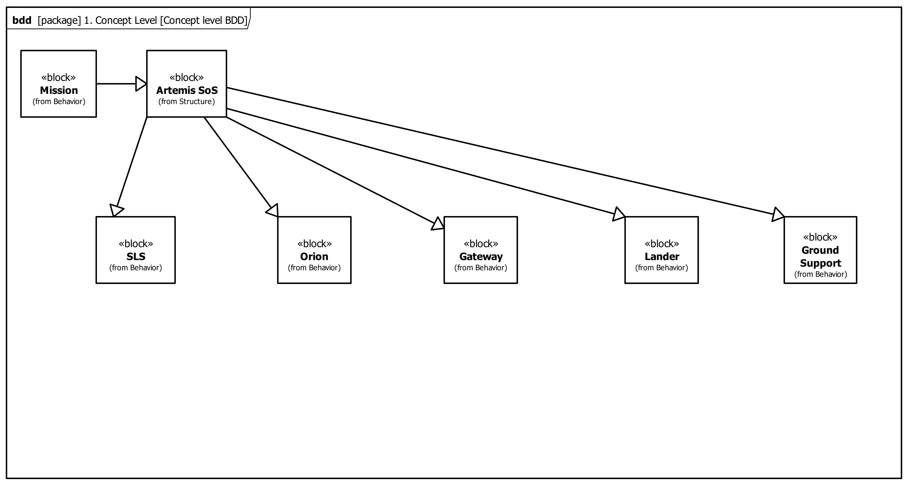
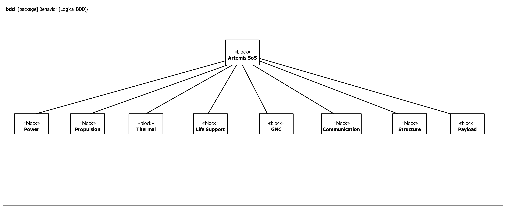
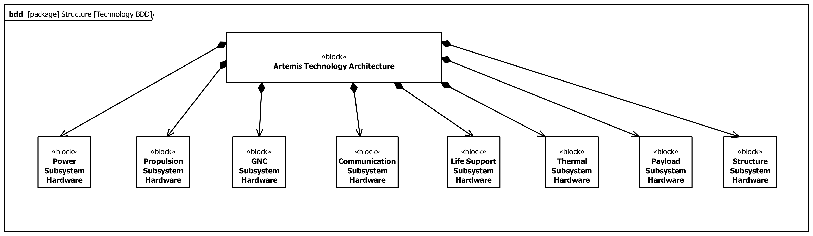
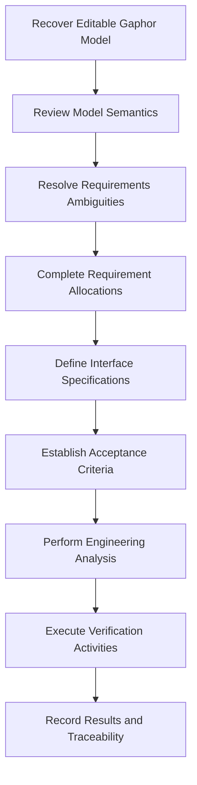

# Artemis Model Consistency and Verification Report

## 1. Introduction

This report documents a review of the academic Artemis
System of Systems architecture developed using Gaphor
and the Systems Modeling Language (SysML).

The review focuses on architecture documentation,
requirements inventory, proposed traceability,
subsystem interfaces, model limitations, and
future engineering verification activities.

The assessment is based on recovered SysML PDF
exports and supplementary repository documentation.

The editable Gaphor model is not available.

Consequently, this report represents a documentation
and exported-model review rather than automated
SysML model verification or spacecraft qualification.

This project is not an official NASA engineering
baseline.

## 2. Verification Objectives

- Confirm the availability of original diagram exports.
- Review architectural decomposition.
- Review consistency of subsystem naming.
- Review requirements inventory completeness.
- Identify requirement identifier conflicts.
- Assess proposed traceability associations.
- Identify unresolved requirement parameters.
- Review subsystem interface definition gaps.
- Propose appropriate verification methods.
- Distinguish documented design intent from
  demonstrated engineering compliance.

## 3. Review Scope

| Review Area | Included |
|---|---|
| Concept-level architecture | Yes |
| Logical-level architecture | Yes |
| Technology-level architecture | Yes |
| Mission requirements | Yes |
| Logical subsystem requirements | Yes |
| Hardware requirements | Yes |
| Original refine and satisfy diagram | Yes |
| Supplementary traceability matrix | Yes |
| Preliminary interface register | Yes |
| Automated editable-model verification | No |
| Numerical mission simulation | No |
| Physical hardware testing | No |
| Flight qualification | No |

The original project report is preserved in
the repository, but its complete contents were
not independently reviewed during this assessment.

## 4. Verification and Validation Methodology

The assessment uses four complementary review
activities.

| Method | Application | Execution Status |
|---|---|---|
| Artifact inspection | Confirm available diagrams and documentation | Performed |
| Documentation consistency review | Review identifiers, inventories, and proposed associations | Performed |
| Quantitative engineering analysis | Evaluate numerical performance and design constraints | Proposed |
| Physical system testing | Verify hardware and integrated system performance | Not performed |

The completed review activities establish
documentation-level findings.

They do not establish system performance,
mission readiness, or compliance with
spacecraft requirements.

## 5. Original Engineering Artifact Inventory

| Artifact Category | Count |
|---|---:|
| Concept-level architecture diagrams | 1 |
| Logical-level architecture diagrams | 4 |
| Technology-level architecture diagrams | 10 |
| Mission requirements diagrams | 2 |
| Subsystem requirements diagrams | 8 |
| Hardware requirements diagrams | 8 |
| Total original SysML exports | 33 |
| Supplementary PNG previews | 7 |
| Original project report | 1 |

The original diagram inventory comprises:

- Four Block Definition Diagrams.
- Eleven Internal Block Diagrams.
- Eighteen requirements-related diagrams.

The seven PNG previews are derived from
selected original PDF exports.

The previews are not additional independent
SysML models.

## 6. Architecture Consistency Review

### 6.1 Concept-Level Architecture

The Concept BDD identifies five major
mission elements:

- SLS
- Orion
- Gateway
- Lander
- Ground Support

The architecture represents the scope of
the academic Gateway-based mission scenario.

The relationship notation should be reviewed
to determine whether composition, association,
or generalization best expresses the
intended system relationships.

The model does not establish the operational
configuration of every Artemis mission.

### 6.2 Logical-Level Architecture

The Logical BDD identifies eight
functional subsystems.

| Functional Subsystem | Represented |
|---|---|
| Power | Yes |
| Propulsion | Yes |
| Thermal | Yes |
| Life Support | Yes |
| GNC | Yes |
| Communication | Yes |
| Structure | Yes |
| Payload | Yes |

The logical decomposition provides
a consistent functional inventory.

Allocation to specific spacecraft and
mission elements requires further development.

### 6.3 Technology-Level Architecture

The Technology BDD identifies eight
hardware-oriented subsystem groups.

Each logical subsystem has a corresponding
hardware subsystem group by naming and
functional responsibility.

This correspondence does not establish
formal SysML allocation relationships.

The editable model is required to verify
the underlying model semantics.

## 7. Logical-to-Technology Architecture Review

| Logical Subsystem | Technology Subsystem | Documentation Correspondence |
|---|---|---|
| Power | Power Subsystem Hardware | Identified |
| Propulsion | Propulsion Subsystem Hardware | Identified |
| Thermal | Thermal Subsystem Hardware | Identified |
| Life Support | Life Support Subsystem Hardware | Identified |
| GNC | GNC Subsystem Hardware | Identified |
| Communication | Communication Subsystem Hardware | Identified |
| Structure | Structure Subsystem Hardware | Identified |
| Payload | Payload Subsystem Hardware | Identified |

All eight logical functional areas have
corresponding hardware-oriented groups.

The correspondence is established through
the exported architecture documentation.

Formal allocation completeness has not
been verified.

## 8. Requirements Inventory Review

The original requirements exports contain
60 documented requirement entries.

| Requirement Level | Expected | Documented |
|---|---:|---:|
| Mission | 12 | 12 |
| Logical subsystem | 32 | 32 |
| Technology hardware | 16 | 16 |
| Total | 60 | 60 |

The supplementary requirements inventory
introduces qualified identifiers.

| Identifier Range | Count |
|---|---:|
| MIS-01 to MIS-12 | 12 |
| SYS-01 to SYS-32 | 32 |
| HW-01 to HW-16 | 16 |

All 60 qualified identifiers are unique
within the supplementary inventory.

The original exported diagrams retain
their original requirement identifiers.

[Requirements Inventory](requirements.md)

## 9. Requirements Quality Review

| Quality Criterion | Review Finding |
|---|---|
| Unique identification | Addressed in supplementary documentation |
| Requirement clarity | Functional intent generally identifiable; ambiguities remain |
| Atomicity | Some requirements contain multiple obligations |
| Measurability | Several numerical acceptance criteria remain undefined |
| Feasibility | Not quantitatively assessed |
| Traceability | Proposed mappings documented; formal model links unverified |
| Verifiability | Proposed methods available; acceptance criteria incomplete |
| Completeness | Original inventory consolidated; additional requirements needed |

The requirements are suitable as a
foundation for academic architecture
development.

Further refinement is required before
they could support detailed engineering
acceptance or qualification.

## 10. Traceability Coverage Review

The supplementary Requirements Traceability
Matrix identifies candidate associations
between architectural levels.

| Association Category | Associated | Total | Coverage |
|---|---:|---:|---:|
| Mission to subsystem | 12 | 12 | 100% |
| Subsystem to hardware | 25 | 32 | 78.125% |
| Hardware to component | 16 | 16 | 100% |

These percentages represent the presence
of candidate associations.

They include partial allocations and
proposed engineering interpretations.

They do not measure demonstrated
requirement satisfaction or complete
end-to-end traceability.

[Requirements Traceability Matrix](traceability_matrix.md)

## 11. Open Traceability Allocations

Seven logical subsystem requirements
do not have sufficiently direct hardware
requirement associations in the current
supplementary matrix.

| Requirement | Open Allocation |
|---|---|
| SYS-04 | Power monitoring hardware |
| SYS-08 | Propellant status measurement |
| SYS-12 | Thermal telemetry hardware |
| SYS-14 | Water recovery hardware |
| SYS-15 | Emergency backup hardware |
| SYS-18 | Guidance processing hardware |
| SYS-28 | Structural health monitoring hardware |

Four payload subsystem requirements,
SYS-29 through SYS-32, also lack a
dedicated science-related mission parent
in the supplementary mission-to-subsystem
matrix.

These open associations are retained
rather than resolved through unsupported
requirement links.

Additional requirements and allocations
should be developed and formally reviewed.

## 12. Original SysML Relationship Review

The original mission requirements
relationship diagram includes refine
and satisfy dependencies.

The diagram establishes the presence
of modeled requirement relationships.

However, the following have not been
formally verified:

- Correctness of every relationship endpoint.
- Semantic validity of every relationship.
- Completeness of requirement allocations.
- Consistency of relationships across levels.
- Requirement-to-test-case relationships.
- Requirement-to-verification-evidence links.

The original diagram remains unchanged.

A satisfy relationship is an intended
design relationship, not evidence of
successful verification.

## 13. Subsystem Interface Review

The supplementary subsystem interface
documentation contains:

| Documentation Item | Count |
|---|---:|
| Functional subsystems reviewed | 8 |
| Logical interface register entries | 16 |
| Requirement-driven interface candidates | 10 |
| Preliminary interface control records | 3 |
| Interface modeling gaps | 11 |

The proposed interface register organizes
candidate electrical, data, control,
mechanical, thermal, and fluid exchanges.

The interface identifiers and exchanged
items are supplementary interpretations.

Detailed connector semantics, signal
directions, protocols, engineering limits,
and physical compatibility remain
subject to further development.

[Subsystem Interface Documentation](subsystem_interfaces.md)

## 14. Architecture Review Findings

| Finding ID | Observed Issue | Recommended Development |
|---|---|---|
| AR-01 | Editable Gaphor model unavailable | Recover original model for formal consistency checks |
| AR-02 | Concept relationship notation requires review | Clarify intended generalization, association, or composition |
| AR-03 | Logical connectors lack complete interface definitions | Add typed ports and item flows |
| AR-04 | Logical-to-hardware correspondence is not formally allocated | Establish explicit allocation relationships |
| AR-05 | GNC sensor roles potentially overlap | Clarify IMU and independent sensor composition |
| AR-06 | RF and antenna pointing interfaces are not differentiated | Separate RF, control, and mechanical connections |
| AR-07 | Thermal monitoring and heat transport groups are not explicitly connected | Define monitoring and control interfaces |
| AR-08 | Thermal insulation and heaters are not separately represented | Complete hardware allocation |
| AR-09 | Life Support component groups lack complete integration | Define environmental monitoring and control |
| AR-10 | Structural monitoring components are not explicitly represented | Define sensing and acquisition architecture |
| AR-11 | Payload science mission parent is not explicitly documented | Develop a mission-level scientific objective |
| AR-12 | Vehicle-specific functional and hardware allocation is incomplete | Allocate functions to individual mission elements |

These findings apply to the available
exported diagrams and supplementary
documentation.

The editable model may contain additional
information that is not visible in
the exported views.

## 15. Unresolved Quantitative Requirements

Several requirements lack the numerical
parameters necessary for verification.

| Parameter Group | Required Definition |
|---|---|
| Mission duration | Minimum surface operating duration |
| Communication | Availability, coverage, and allowable outage |
| Electrical power | Bus voltage, current, and load limits |
| Energy storage | Capacity and operating duration |
| Propulsion | Total impulse and thrust operating limits |
| Thermal | Allowable temperatures and heat rejection |
| Life Support | Atmospheric and water recovery limits |
| GNC | Navigation and attitude accuracy |
| Structure | Mechanical load cases and allowable limits |
| Payload | Instrument performance and data rates |
| Emergency operation | Abort scenarios and safe-return criteria |

### Explicit Propulsion Placeholders

The original propulsion hardware requirements
contain the following unresolved parameters.

| Parameter | Requirement | Status |
|---|---|---|
| D | Minimum total impulse in N·s, HW-03 | TBD |
| E | Minimum adjustable thrust percentage, HW-04 | TBD |
| F | Maximum commandable thrust resolution percentage, HW-04 | TBD |

No numerical values are assigned without
supporting engineering data.

[Original Propulsion Hardware Requirements](../diagrams/requirements/hardware_level/Propulsion_Subsystem_Hardware.pdf)

The consolidated requirements document
identifies 19 unresolved parameter groups.

## 16. Proposed Subsystem Verification Plan

The following verification activities
are proposed for future engineering work.

| Subsystem | Proposed Verification Activity | Required Evidence |
|---|---|---|
| Power | Electrical load and energy storage analysis | Power budget, regulation tests, discharge results |
| Propulsion | Maneuver capability and thrust analysis | Impulse, thrust, and control performance |
| Thermal | Heat transfer analysis and thermal testing | Temperature limits and heat rejection results |
| Life Support | Environmental system testing | Atmospheric, water, and backup operation results |
| GNC | Navigation and control analysis | Navigation accuracy and actuator performance |
| Communication | Link analysis and integration testing | Link budget, command and telemetry results |
| Structure | Structural analysis and mechanical testing | Load cases, stress results, and vibration performance |
| Payload | Instrument and data interface testing | Measurement, storage, and data transfer results |

These activities are not completed tests.

Acceptance criteria must be defined before
execution.

## 17. Detailed Logical Requirement Verification Plan

The following table extends verification
planning to all 32 logical requirements.

| Requirement | Proposed Method | Acceptance Basis Requiring Definition |
|---|---|---|
| SYS-01 | Analysis and test | Continuous electrical supply and voltage limits |
| SYS-02 | Electrical load test | Peak load magnitude and duration |
| SYS-03 | Analysis and discharge test | Stored energy and operating duration |
| SYS-04 | Functional test | Voltage, current, and state-of-charge telemetry |
| SYS-05 | Analysis and test | Required maneuver capability |
| SYS-06 | Actuation test | Attitude maneuver support |
| SYS-07 | Functional test | Throttle stability and operating limits |
| SYS-08 | Sensor and telemetry test | Propellant measurement and reporting accuracy |
| SYS-09 | Thermal test | Allowable equipment temperature ranges |
| SYS-10 | Environmental test | Cabin temperature range |
| SYS-11 | Thermal analysis and test | Heat dissipation capability |
| SYS-12 | Sensor and telemetry test | Temperature measurement and reporting performance |
| SYS-13 | Environmental test | Safe atmospheric operating ranges |
| SYS-14 | Functional test | Water recovery and storage capacity |
| SYS-15 | Demonstration and test | Emergency operation duration |
| SYS-16 | Integration test | Environmental telemetry delivery |
| SYS-17 | Analysis and test | Position, velocity, and attitude accuracy |
| SYS-18 | Functional test | Guidance command accuracy and timing |
| SYS-19 | Control system test | Attitude stabilization performance |
| SYS-20 | Sensor integration test | Multisensor fusion performance |
| SYS-21 | Analysis and test | Communication availability |
| SYS-22 | RF analysis and test | High-gain link performance |
| SYS-23 | Integration test | Telemetry routing and data integrity |
| SYS-24 | Functional and integration test | Command authentication and forwarding behavior |
| SYS-25 | Structural analysis and test | Allowable mission loads |
| SYS-26 | Inspection and test | Mounting compatibility and load limits |
| SYS-27 | Inspection and integration test | Docking, landing, and thermal interface compatibility |
| SYS-28 | Sensor and integration test | Structural monitoring accuracy and reporting |
| SYS-29 | Instrument test | Scientific measurement performance |
| SYS-30 | Data transfer test | Storage and downlink performance |
| SYS-31 | Thermal integration test | Instrument operating temperatures |
| SYS-32 | Functional test | Operational command execution |

All 32 verification activities are proposed
and have not been executed.

Together with the mission and hardware
verification matrices in the RTM,
the documentation provides proposed
verification methods for all 60 requirements.

## 18. Documentation Verification Checklist

| Review ID | Review Activity | Result |
|---|---|---|
| DV-01 | Original diagram inventory | 33 exports documented |
| DV-02 | Concept architecture availability | Confirmed |
| DV-03 | Logical architecture availability | Confirmed |
| DV-04 | Technology architecture availability | Confirmed |
| DV-05 | Functional subsystem inventory | Eight documented |
| DV-06 | Hardware subsystem inventory | Eight documented |
| DV-07 | Mission requirements inventory | 12 documented |
| DV-08 | Subsystem requirements inventory | 32 documented |
| DV-09 | Hardware requirements inventory | 16 documented |
| DV-10 | Qualified requirement identifier uniqueness | 60 unique identifiers |
| DV-11 | Candidate mission associations | 12 of 12 |
| DV-12 | Candidate subsystem hardware associations | 25 of 32 |
| DV-13 | Candidate hardware component associations | 16 of 16 |
| DV-14 | Open hardware allocations | Seven documented |
| DV-15 | Original requirements relationship diagram | Available |
| DV-16 | Supplementary subsystem interface register | Available |
| DV-17 | Unresolved requirement parameters | Documented |
| DV-18 | Formal editable-model consistency | Not assessed |
| DV-19 | Numerical engineering performance | Not assessed |
| DV-20 | Physical spacecraft compliance | Not assessed |

The checklist records documentation review
findings.

It does not represent completed spacecraft
acceptance testing.

## 19. Verification Planning and Compliance Status

| Requirement Level | Documented | Proposed Verification Methods | Demonstrated Compliance |
|---|---:|---:|---:|
| Mission | 12 | 12 | 0 |
| Logical subsystem | 32 | 32 | 0 |
| Technology hardware | 16 | 16 | 0 |
| Total | 60 | 60 | 0 |

Proposed verification planning coverage
is 60 out of 60 documented requirements.

No demonstrated requirement compliance
has been established by this review.

The difference between these two metrics
is essential for accurate engineering
reporting.

## 20. Recommended Engineering Development Sequence

This sequence represents proposed future
engineering activities.

It does not represent completed project
milestones.

## 21. Review Limitations

- The editable Gaphor model is unavailable.
- The complete original report has not been independently reviewed.
- Formal SysML model consistency checking has not been performed.
- Original relationship semantics have not been fully audited.
- Proposed interface definitions require engineering review.
- Candidate requirement mappings include partial allocations.
- Several numerical acceptance criteria remain undefined.
- Vehicle-specific architecture allocation remains incomplete.
- Numerical spacecraft performance has not been evaluated.
- Physical integration and hardware tests have not been performed.
- Mission validation and flight qualification have not been established.
- No official NASA approval or compliance is claimed.

## 22. Supporting Documentation

- [Mission Overview](mission_overview.md)
- [System Architecture](system_architecture.md)
- [Subsystem Interfaces](subsystem_interfaces.md)
- [Requirements Inventory](requirements.md)
- [Requirements Traceability Matrix](traceability_matrix.md)
- [Original Concept BDD](../diagrams/concept_level/Concept_level_BDD.pdf)
- [Original Logical BDD](../diagrams/logical_level/Logical_BDD.pdf)
- [Original Technology BDD](../diagrams/technology_level/Technology_BDD.pdf)
- [Original Requirements Relationships](../diagrams/requirements/mission_level/Requirements%20with%20refine%20and%20satisfy%20links.pdf)
- [Original Project Report](../ARTEMIS%20MISSION%20AND%20SPACECRAFT%20ARCHITECTING%20USING%20GAPHOR.pdf)

## 23. Conclusion

The Artemis architecture documentation review
consolidates 33 original SysML exports and
60 documented requirements across three
architectural levels.

The supplementary documentation establishes
unique requirement identifiers, proposed
traceability associations, interface
engineering records, and verification
planning for all 60 requirements.

The review identifies open allocations,
unresolved quantitative requirements,
and architecture development opportunities.

The project demonstrates the application
of model-based systems engineering,
requirements management, architecture
analysis, and verification planning.

Formal model verification, quantitative
engineering analysis, physical validation,
and mission compliance remain future work.
